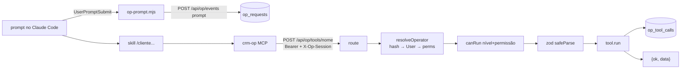

# Operação por IA (Claude Code → CRM) — mapa para IA
> Verificado em 2026-10-27 · Escopo: Itens A–P de 27/10 (§4 de `docs/ai-first/10-decisoes-dono-27-10.md`, respostas do dono): `app/_shared/lib/op/{jobs,progress,hospitais,record,workflow}.ts`, `app/_shared/lib/op/tools/{lotes,listar-colunas,listar-historico,listar-cards-coluna,buscar-cliente,varredura,consultar-hospital,fluxos,relatorio,meu-dia}.ts`, `app/api/op/{tools/[tool],events,jobs/run}/route.ts`, `app/_shared/utils/{op-registro,op-metrics,op-varredura,workflows}.ts`, `app/_shared/lib/db/automations.ts` (invalidação), `app/_shared/lib/permissions.ts` (`op_approve`), `prisma/schema.prisma` (`OpJob`, `OpRequest.clientKey`, `OpToolCall.previaHash/avisos`), `tools/crm-mcp/index.mjs`, `.claude/hooks/op-prompt.mjs`, `vercel.json` (cron de 5 min), `tests/{op-registro,op-hospitais,op-progress,op-jobs}.test.ts`; Decisões de 27/10 (`docs/ai-first/10-decisoes-dono-27-10.md`): `app/_shared/lib/op/preview.ts` (confirmação direta × exigida), `app/_shared/lib/op/{comms,doc-analysis,record}.ts`, `app/_shared/lib/op/tools/{comunicacao,documentos,analisar-documentos,panorama-card,verificar-pendencias,listar-documentos,meu-dia}.ts` (+ descrições de todas as L3), `app/_shared/utils/{op-lote,doc-extract,wa-send-plan}.ts`, `app/_shared/lib/ai-audit.ts` (helpers exportados), `tools/crm-mcp/index.mjs` (JSON compacto), `.claude/hooks/op-prompt.mjs` (POST desacoplado), `.claude/settings.json` (allow), `.claude/skills/{crm,whatsapp,documentos}/` + todas as skills de operação reescritas, `tests/{op-lote,doc-extract,op-doc-analysis}.test.ts`; Ajustes de 26/10 (`docs/ai-first/09-decisoes-dono-26-10.md`): `app/_shared/utils/cadastro-ia.ts`, `app/_shared/lib/cards/{cadastro,documents,comment-edit,delete}.ts`, `app/_shared/lib/mention-status.ts`, `app/_shared/lib/op/{irreversivel,retencao}.ts`, `app/_shared/lib/op/tools/{editar-cadastro,gerenciar-documento,comentario-tarefa,quem-pediu}.ts`, `OpWorkflow` (`op_workflows`), `scripts/{op-backup-retencao,op-backup-ler}.mjs`, `.claude/skills/meu-rendimento/`, `tests/{op-ajustes-26-10,op-retencao}.test.ts`; Etapa 7: `app/_shared/utils/{op-metrics,op-varredura}.ts`, `app/_shared/lib/op/metrics.ts`, `app/_shared/lib/op/tools/{relatorio,varredura}.ts`, `app/_actions/op/metrics.ts`, `.claude/skills/{auditoria-operacao,varredura}/`, `tests/{op-metrics,op-metrics-lib,op-varredura}.test.ts`; Etapa 6: `app/_shared/utils/workflows.ts`, `app/_shared/lib/op/workflow.ts`, `app/_shared/lib/op/tools/fluxos.ts`, `hasSwitch` (`op/switches.ts`), `.claude/skills/retomar/` + seção "Progresso" de `.claude/skills/{prontuario,procuracao,pedido-prontuario,contrato}/`, `tests/{workflows,op-workflow}.test.ts`; Etapa 5: `app/_shared/lib/op/{approvals,comms}.ts`, `app/_shared/lib/op/tools/comunicacao.ts`, `app/_shared/utils/{approval-code,email-mime,wa-send-plan,hospital-contact}.ts`, `sendEmailRawAws` (`app/_shared/lib/aws-messaging.ts`), `prisma/schema.prisma` (`OpApproval`, `User.hospital_*`), `scripts/vault-hospitais-para-ghost.mjs`, `.claude/skills/prontuario/`, `tests/{approval-code,email-mime,wa-send-plan,hospital-contact,op-approvals,op-comms}.test.ts`; Etapa 4: `app/_shared/lib/op/tools/documentos.ts`, `app/_shared/lib/docs/{drafts,converter}.ts`, `app/_shared/utils/doc-fields.ts`, `.claude/skills/{procuracao,pedido-prontuario,contrato}/`, `tests/{doc-fields,op-drafts,op-converter}.test.ts`; Etapa 3: `app/_shared/lib/cards/*`, `app/_shared/lib/notifications.ts`, `app/_shared/lib/op/{preview,switches}.ts`, `app/_shared/lib/op/tools/{_escrita,mover-card,tags-card,comentar-card,notificar-pessoa,arquivar-card,meu-dia}.ts`, `app/_actions/op/switches.ts`, seção "IA de operação" (tela no branch ia-operacao-telas, fora da main), `.claude/skills/meu-dia/`, `tests/{card-writes,op-preview,meu-dia}.test.ts`; Etapas 1–2: `app/_shared/lib/op/**`, `app/api/op/**`, `app/_actions/team/operator-tokens.ts`, `app/nova-dash/_components/OperatorTokensDialog.tsx`, `tools/crm-mcp/` (fora do Next), `.mcp.json`, `.claude/hooks/{op-prompt,op-tool,guard-secrets,guard-bash,bash-rules}.mjs`, `.claude/skills/{cliente,processo,parados,pendencias}/`, `prisma/schema.prisma` (`OperatorToken`, `OpSession`, `OpRequest`, `OpToolCall`), `tests/{op-policy,op-resolve,op-registry,op-auth,guard-bash,vault}.test.ts`; Etapa 2: `docs/operacao/` (vault), `app/_shared/utils/vault.ts`, `scripts/{vault-seed-hospitais,vault-check,vault-publicar,sync-vault-s3,mapa-etapas}.mjs`, `.claude/agents/{redator,validador}-conhecimento.md`, `.claude/skills/{hospital,conhecimento,publicar-conhecimento}/`. Plano e decisões: `docs/ai-first/00-diagnostico-etapa-zero.md`, `docs/ai-first/01-plano-etapa-1.md`, `docs/ai-first/02-plano-etapa-2.md`.

## TL;DR
- **30/10 (decisão do dono)**: a IA cria — `criar_card` (L3 `op_write`; direta, `requer_confirmacao` com os `parecidos` quando CPF/telefone já está no CRM; card nasce **sem senha**), `criar_ticket_dev` (L3, ticket DEV BUG/ALTERACAO/MELHORIA/OUTRO, confirmação exigida) e `preparar_membro_equipe` (L4 `op_approve` + `manage_team` conferido no preparar e no executar; canal `equipe` em `op_approvals`; só ADMIN/ADMIN+; sem senha — entra pelo "Esqueci minha senha"). Site e IA criam pela mesma lib `app/_shared/lib/cards/create.ts` (`createUserRow`) e `criarTicketDev` (`cerebro-tickets.ts`). **Plugin do operador**: a equipe usa as skills pelo app do Claude sem o repositório — `scripts/plugin-operacao.mjs` monta skills de operação + MCP + hooks (`tools/operacao-plugin/`) para o repositório privado `crm-operacao-plugin` (marketplace `seguros-parana`, plugin `crm`, skills `/crm:<nome>`, ferramentas `mcp__plugin_crm_crm-op__*`); token no `userConfig` (cofre do sistema), pasta `C:\CRM-Operacao` nega Bash/Edit/Write.
- **Decisões de 27/10** (`docs/ai-first/10-decisoes-dono-27-10.md`): L3 executa **direto** com `confirmar: true` (`previewOrExecute` com `confirmacao: "direta"`); só 4 casos pedem o OK antes e voltam `requer_confirmacao` (409) com a prévia — mover para coluna que manda WhatsApp, anexar contrato/KIT, documento para a lixeira, trocar campo preenchido. L3 diretas, L2 e L1 de registro estão no `allow` do `.claude/settings.json` (`executar_aprovado` e `preparar_acao_irreversivel` não). **Lote**: `preparar_whatsapp` com `cards` (≤ 20, variáveis `[[nome]]`/`[[primeiro_nome]]`/`[[numero]]`/`[[hospital]]`), `preparar_email` com `lote` (≤ 10), `anexar_rascunho` com `rascunhos` (≤ 10), `verificar_pendencias` com `cards` (≤ 50) — uma aprovação para N envios, resultado por card. **Sem cooldown** no envio aprovado (`transactional: true`; opt-out/opt-in/janela/pausa valem). **`analisar_documentos`** (L1, `run_ai_audit`) lê os arquivos da pasta com o Claude e devolve divergências + sugestões para `editar_cadastro`; **`panorama_card`** junta ficha + histórico + documentos + pendências + conversa numa chamada. Skills curtas com bloco **Formato**; regras completas em `.claude/skills/crm/SKILL.md`. Hook `op-prompt.mjs` não bloqueia o prompt (POST num processo filho; só o "aprovo" é síncrono). MCP devolve JSON compacto; `listar_documentos` sem links por padrão.
- **Itens A–P (27/10, tarde)**: registro de `op_tool_calls` em `runAfterResponse` e pedido ligado pela chave `X-Op-Request` (A); cada chamada guarda `previaHash` + `avisos` e o relatório `ignorados` mostra prévia exigida sem OK, envio apesar do aviso e cards pulados (G); `op_approve` nasce em todo cargo (L); `resolveColumn` sem `groupBy` (D); filtros no histórico, CPF/telefone na coluna, prazo na busca (E); cache de 5 min de automações/GHOST/cards por hospital (B); varredura com um item por duplicata e `sugestao` de qual manter (C); MCP recarrega o catálogo (P); progresso de fluxo gravado pelas próprias ferramentas (I); aprovação pendente da mesma sessão reaproveitada ao retomar (J); rascunho pertence ao card (K); fila `op_jobs` (tique na hora + cron de 5 min) **opcional**, só a pedido do operador — o padrão continua a análise na hora em paralelo (O).
- **Telas fora da `main` (25/10)**: o painel de interruptores e o de rendimento, a seção "IA de operação" no menu do Espaço de Trabalho, a origem "IA" na Caixa de Menções e os rótulos novos do histórico do card ficaram no branch `ia-operacao-telas`, para o dono refazer as telas. As actions (`app/_actions/op/switches.ts`, `app/_actions/op/metrics.ts`) estão na `main`, sem tela que as chame. Para ligar/desligar sem o painel: `scripts/op-interruptores.mjs` (sem args lista; `--ligar=a,b` / `--desligar=a` / `--desligar-tudo` em dry-run; `--apply --autor=<e-mail do Super Admin>` grava pelo mesmo `setOpSwitch`, com log `op_switch`).
- O operador trabalha **dentro do Claude Code neste repositório**. As skills `/cliente`, `/processo`, `/parados`, `/pendencias` chamam ferramentas `crm-op` (MCP fino em `tools/crm-mcp/index.mjs`), que viram `POST /api/op/tools/<nome>` no CRM com o token do operador.
- Toda regra mora no CRM: token → `User` da equipe → permissões **do banco** (`resolvePermissions`) → nível da ferramenta (`canRun`) → args validados por zod → execução → registro em `op_tool_calls`. O MCP só transporta.
- Etapas 1–2 = leitura (12 ferramentas L1). **Etapa 4** = documentos: `listar_modelos` (L1), `preparar_procuracao`/`preparar_pedido_prontuario`/`preparar_contrato` (**L2**: rascunho PDF só no S3 `op-drafts/`, card intocado; campo faltando sem `permitir_vazios` = nada gerado) e `anexar_rascunho` (L3, vira `Document`). **Etapa 3** = `meu_dia` (L1) + 6 ferramentas de escrita L3 (`mover_card`, `adicionar_tag`, `remover_tag`, `comentar_card`, `notificar_pessoa`, `arquivar_card`). **Etapa 5** = envio para fora (L4): `preparar_email`/`preparar_whatsapp` gravam a aprovação pendente (`op_approvals`) e devolvem um código; `executar_aprovado` só envia se a **última mensagem do operador** na mesma conversa for `aprovo <código>` (prompt gravado pelo hook, que o modelo não escreve), o hash bater e não tiverem passado 30 min. `OP_MAX_LEVEL = 4`. Toda L3: sem `confirmar` só devolve a **prévia + `previa_hash`**; com `confirmar: true` + hash executa se o estado não mudou (`estado_mudou` 409); exige `op_write` (padrão só ADMIN++) e o **interruptor** da ferramenta ligado (`app_settings` `op_l3_switches`, seção "IA de operação" do Espaço de Trabalho; desligado por padrão). Autor = `"<nome> (via IA)"`, `metadata.source = "op"` + `metadata.op = {sessionId, requestId}`.
- **Etapa 6** = fluxos longos com retomada: `salvar_progresso` grava o passo feito (ou onde parou) em `op_workflows` (tabela própria desde 26/10; o fluxo é do **card**: qualquer operador retoma o de um colega, com `startedById`/`lastOperatorId`/`operatorIds`); `fluxos_abertos` e `retomar_fluxo` (skill `/retomar`) mostram o que já foi feito e ainda vale, o que refazer e o próximo passo. Só ids/keys no estado; ref conferido no servidor; aprovação L4 nunca se reaproveita. `salvar_progresso` é L1 com interruptor (`switchable`), desligado por padrão.
- Cada prompt vira `op_requests` (hook `UserPromptSubmit`), cada ferramenta vira `op_tool_calls` (pela rota). **Etapa 7** = leitura disso: painel "Operação por IA — rendimento" no Espaço de Trabalho → IA de operação (só `manager_dashboard`, por server action), ferramenta `gerar_relatorio` (L1, `manager_dashboard`, sem texto de prompt) para a skill `/auditoria-operacao`, e `varrer_inconsistencias` (L1, `op_use`) para a `/varredura`. Uma lib só (`op/metrics.ts` + puros em `op-metrics.ts`) para os três.
- **Base de conhecimento (Etapa 2)**: vault `docs/operacao/` (notas `.md` com frontmatter, abre no Obsidian). Notas de hospital nascem do seed das automações de "DISTRIBUIÇÃO DE SOLICITAÇÕES" (bloco `## Fonte` literal + `fonte_hash`); agente redator escreve, `vault-check` + agente validador conferem, script muda o status; publicadas sobem para o S3 (`operacao-vault/`) e a ferramenta `consultar_hospital` lê de lá junto com o texto vivo da automação.
- O que mais quebra: (1) rota nova em `app/api/op/` que esquece `opAuth` (está em `PUBLIC_API_PREFIXES`: sem `opAuth`, fica **aberta**); (2) ferramenta que seleciona `senha_inss`/`password` e devolve; (3) ferramenta que escreve no CRM sem subir de nível.

## Onde fica
| Arquivo | Responsabilidade | Símbolos-chave |
|---|---|---|
| `app/_shared/lib/op/auth.ts` | Token do operador: gerar, hash, Bearer, resolver para `User` + permissões, rate limit | `generateOperatorToken`, `hashOperatorToken`, `parseBearer`, `operatorFromTokenRow`, `resolveOperator`, `issueOperatorToken`, `requireOpPermission`, `OpAuthError`, `OperatorContext`, `OP_TOKEN_PREFIX` |
| `app/_shared/lib/op/policy.ts` | Puro: níveis, decisão de execução (L4 exige `op_approve`), hash canônico (amarra a aprovação L4), remoção de senhas/credenciais | `OP_MAX_LEVEL`, `canRun`, `canonicalJson`, `canonicalHash`, `stripSensitive`, `truncate` |
| `app/_shared/lib/op/resolve.ts` | Puro: referência de card, CPF × telefone, nome de coluna, dias em Brasília | `parseCardRef`, `isValidCpf`, `normalizeColumnName`, `matchColumn`, `brDaysBetween`, `brDateTime`, `brDate` |
| `app/_shared/lib/op/registry.ts` | Contrato da ferramenta + zod → JSON Schema (`zod/v4`) | `defineTool`, `OpTool`, `OpToolResult`, `OpToolError`, `catalogEntry`, `toJsonSchema`, `describeZodError` |
| `app/_shared/lib/op/cards.ts` | Consultas de card compartilhadas (filtro de card, busca por CPF/telefone, referência → 1 card) | `CARD_WHERE`, `ACTIVE_CARD_WHERE`, `NOT_CARD_ROLES`, `cardListSelect`, `cardIdsByCpf`, `cardIdsByPhone`, `resolveOneCardId`, `etapaLabel`, `columnName` |
| `app/_shared/lib/op/record.ts` | Registro em `op_sessions`/`op_requests`/`op_tool_calls` (a rota grava a chamada em `runAfterResponse`; pedido pela `clientKey` do header `X-Op-Request`, fallback último prompt da sessão) | `ensureOpSession`, `recordPrompt`, `requestIdByClientKey`, `latestRequestId`, `recordToolCall`, `skillFromPrompt` |
| `app/_shared/utils/op-registro.ts` | Puro (item G): o que fica de cada chamada além do resumo — hash da prévia (emitido/recebido) e avisos em códigos (`aviso`, `marketing`, `destino_livre`, `requer_confirmacao`, `pulados:N`, `nao_enviados:N`) | `registroDaChamada`, `avisosDoResultado`, `previaHashEmitido` |
| `app/_shared/lib/op/hospitais.ts` | Automações por hospital, GHOSTs e cards ativos por hospital com **cache de 5 min por instância** (item B; `invalidateHospitalCache` chamado por `lib/db/automations.ts` em create/update/delete) | `loadHospitalGroups`, `loadGhosts`, `ghostFor`, `activeCardsByHospital`, `hospitalContactFor`, `loadVaultIndex`, `invalidateHospitalCache` |
| `app/_shared/lib/op/progress.ts` | Item I: progresso automático — a ferramenta que faz o passo grava em `op_workflows` se o interruptor de `salvar_progresso` está ligado e há fluxo aberto do card na vez daquele passo; nunca abre fluxo, nunca lança | `autoProgress`, `PROGRESS_SWITCH` |
| `app/_shared/lib/op/jobs.ts` · `tools/lotes.ts` · `app/api/op/jobs/run/route.ts` | Item O: fila `op_jobs` (criar com dedupe/pulados, claim atômico por status+`claimedAt`, processar item a item com orçamento de 240 s e gravação por item, leitura só do próprio operador) · `iniciar_lote`/`resultado_lote` · cron GET de 1 min (`CRON_SECRET`, `maxDuration` 300) | `createJob`, `claimJob`, `runJob`, `runJobsTick`, `pendingJobsFor`, `loadJobFor`, `purgeOldJobs`, `JOB_MAX_ITENS` |
| `app/_shared/lib/op/approvals.ts` | Aprovação L4: criar (hash + código), achar o "aprovo" digitado, executar uma vez (reserva atômica) | `createApproval`, `loadApproval`, `findTypedApproval`, `executeApproval` |
| `app/_shared/lib/op/comms.ts` | Monta/valida e-mail (destino do cadastro, cc, anexos com ETag) e WhatsApp (contato do card, plano de envio); despacha o aprovado + comentário + log `op_send` | `prepareEmail`, `precheckEmail`, `sendApprovedEmail`, `prepareWhatsapp`, `precheckWhatsapp`, `sendApprovedWhatsapp` |
| `app/_shared/utils/approval-code.ts` · `email-mime.ts` · `wa-send-plan.ts` · `hospital-contact.ts` | Puros: código curto + regex do "aprovo" · MIME `multipart/mixed` (cc, anexo UTF-8, anti-injeção) · régua do `sendSystemWhatsApp` antes de preparar + telefone do card × contato · contato do GHOST a partir de nota publicada | `approvalCode`, `typedApprovalMatches`, `buildMimeMessage`, `isValidEmail`, `planWhatsAppSend`, `samePhoneBR`, `ghostContactFromNote` |
| `scripts/vault-hospitais-para-ghost.mjs` | Backfill das colunas `hospital_*` dos GHOST a partir das notas publicadas (dry-run READ ONLY; `--apply` só grava coluna vazia) | — |
| `app/_shared/utils/workflows.ts` | Puro (Etapa 6): passos de cada fluxo (`WORKFLOWS`, tipos `reler`/`rascunho`/`anexo`/`aprovacao`/`envio`/`registro`/`operador`), schema zod v1 do estado (só ids; bloqueio com listas fechadas), ordem, marcação, retomada | `WORKFLOWS`, `workflowStateSchema`, `parseWorkflowState`, `checkStep`, `nextStep`, `currentStep`, `markDone`, `block`, `finish`, `isStale`, `resumePlan`, `campoKey`, `BLOQUEIO_CODIGOS`, `containsPii` |
| `app/_shared/lib/op/workflow.ts` | Lib (Etapa 6): fluxos abertos do operador, salvar sob advisory lock (claim do prompt de origem), conferência do ref na fonte, releitura para retomar (rascunho, anexo, aprovação, card) | `openFlows`, `saveProgress`, `verifyStepRefs`, `cleanBloqueio`, `listOpenFlows`, `loadForResume` |
| `app/_shared/lib/op/http.ts` | Respostas `{ok:false, code, message}` e auth para route handler | `opAuth`, `opFail` |
| `app/_shared/lib/op/tools/*.ts` | Uma ferramenta por arquivo; `index.ts` lista todas | `OP_TOOLS`, `getTool`, `loadColumns`, `resolveColumn`, `cardRefSchema` |
| `app/_shared/lib/op/doc-analysis.ts` · `app/_shared/utils/doc-extract.ts` | 27/10: leitura dos arquivos do card com o Claude (reaproveita `fetchS3Buffer`/`mediaKind`/`callClaude` exportados de `ai-audit.ts`; log `op_doc_analysis` com `usage`) · puro: parse tolerante do JSON da IA, consolidação por tipo de documento, comparação com o cadastro, sugestões | `analyzeCardDocuments` · `parseExtracted`, `consolidate`, `compareWithCard`, `normalizeDateBR`, `CAMPOS_COMPARADOS` |
| `app/_shared/utils/op-lote.ts` | 27/10, puro: tetos do lote, variáveis `[[nome]]`… (`fillCardVars`), `dedupeRefs`/`refKey`, prévia em texto do lote, resultado por item | `LOTE_WHATSAPP_MAX`, `LOTE_EMAIL_MAX`, `LOTE_ANEXOS_MAX`, `fillCardVars`, `previaTextoLote`, `loteOutcome` |
| `app/api/op/tools/route.ts` | `GET` catálogo (nome, descrição, JSON Schema, nível, permissão, `permitido`) | `GET` |
| `app/api/op/tools/[tool]/route.ts` | `POST` executa uma ferramenta (`maxDuration` 60) | `POST` |
| `app/api/op/events/route.ts` | `POST` eventos dos hooks: `prompt`, `session_start`, `tool_error` | `POST` |
| `app/_actions/team/operator-tokens.ts` | Gerar/listar/revogar token (`manage_team`), log `update` com `metadata.stage = "operator_token"` | `listOperatorTokens`, `createOperatorToken`, `revokeOperatorToken`, `OperatorTokenDTO` |
| `app/nova-dash/_components/OperatorTokensDialog.tsx` | Botão "Token do app" na tela Equipe (`team_dash.tsx`): mostra o token uma vez | default `OperatorTokensDialog` |
| `tools/crm-mcp/index.mjs` · `.mcp.json` | MCP stdio sem dependências: `initialize`, `ping`, `tools/list`, `tools/call`; ferramenta local `diagnostico_crm`; manda `X-Op-Session`/`X-Op-Request`; catálogo com TTL de 60 s, zerado em `ferramenta_desconhecida`/`ferramenta_desligada`/`sem_permissao` com `notifications/tools/list_changed` (item P: sem reiniciar) | — |
| `.claude/hooks/op-prompt.mjs` · `op-tool.mjs` | `UserPromptSubmit` → gera `requestKey` (uuid), grava `~/.claude/crm-op/session.json` (`sessionId`, `requestKey`, `at`) e manda o evento `prompt` (POST desacoplado; "aprovo" síncrono); `PostToolUse` (`mcp__crm-op__.*`) → `tool_error` só para falha de transporte | — |
| `scripts/op-relatorio.mjs` | Relatório de uso de `op_*` em transação READ ONLY | — |
| `app/_shared/utils/op-metrics.ts` | Puro (Etapa 7): período em dias de Brasília (≤ 90), classificação do prompt sem ler o texto (conversa/consulta/ação; conversa fica fora de TODO número), tipo da chamada (prévia/execução/noop/preparo/falha), agregação por operador/dia, definições de cada número | `OP_SKILLS`, `resolveOpPeriod`, `OpPeriodError`, `classifyPrompt`, `callKind`, `approvalStatus`, `flowStatus`, `buildOpMetrics`, `OP_METRIC_DEFINITIONS`, `dayKeysBetween` |
| `app/_shared/lib/op/metrics.ts` | Lib (Etapa 7): linhas de `op_*` do período com select mínimo (sem `text`/`args`; `confirmar`/`noop` no SQL), nomes e cards; texto dos prompts paginado e com token mascarado; operadores do período | `loadOpMetricRows`, `getOpMetrics`, `getOpPrompts`, `maskOpToken`, `listOpOperators`, `OpMetricsView` |
| `app/_actions/op/metrics.ts` · painel de rendimento (tela no branch ia-operacao-telas, fora da main) | Actions da tela (`requirePermission("manager_dashboard")`, sem poll) · painel acima dos interruptores: período 7/30/90/datas, operador, totais, por operador, consultas frequentes, falhas por código, envios, fluxos parados, cards conduzidos (abre o card), ferramentas, "Pedidos (texto)" por clique | `getOpMetricsAction`, `getOpPromptsAction`, painel de rendimento (tela no branch ia-operacao-telas, fora da main) |
| `app/_shared/utils/op-varredura.ts` | Puro (Etapa 7): checagens fixas da `/varredura` com regra + fonte + evidência | `VARREDURA_CHECAGENS`, `VARREDURA_REGRAS`, `HOSPITAL_COLUMNS_RE`, `findInconsistencies` |
| `.claude/skills/auditoria-operacao/` · `varredura/` | Auditoria por período sobre `gerar_relatorio` (+ `listar_historico` como evidência), "O que melhorar" sempre com evidência e quem faz · varredura sobre `varrer_inconsistencias` + `listar_cards_parados` + `fluxos_abertos`, uma correção L3 por vez | — |
| `scripts/mapa-etapas.mjs` | Mapa do que cada coluna recebe e do que o card tem ao sair, pelos `logs` (só leitura, só números agregados); base das notas de etapa da Etapa 2 | — |
| `app/_shared/utils/vault.ts` | Puro (vault): nome/slug de hospital (sem `[HOSPITAL] `), texto e hash da fonte, regex de contatos, frontmatter (1 linha por campo, listas em JSON), decisão do seed, regras da nota, índice | `normalizeHospitalName`, `slugify`, `automationSourceText`, `sourceHash`, `extractContacts`, `contactsNotIn`, `parseNote`, `renderNote`, `decideSeed`, `checkNote`, `renderIndex`, `sampleOf` |
| `scripts/vault-seed-hospitais.mjs` | Seed (READ ONLY no banco): `hospitais/*.md`, `modelos/email-prontuario.md`, `_relatorios/lacunas.md`, `_modelo-nota.md`, `Mapa da Operação.md`; dry-run sem `--apply` | — |
| `scripts/vault-check.mjs` | Validador determinístico (`--arquivos=`, `--drift` lê o banco, `--json`); exit 1 com erro | — |
| `scripts/vault-publicar.mjs` | `proximos` (fila do lote) · `marcar` (única forma de mudar `status`; recusa o que não passa no `checkNote`) · `relatorio` (amostra de 10%) | — |
| `scripts/sync-vault-s3.mjs` | Sobe só `publicado` para `operacao-vault/` + manifesto index.json; idempotente por sha256; `--prune` para apagar | — |
| `app/_shared/lib/docs/drafts.ts` | Rascunho de documento da IA: modelos com tipo/tags, conferência de campos, geração no S3 `op-drafts/`, leitura dos metadados, anexar como `Document`, purga de 7 dias | `listDraftTemplates`, `checkDraft`, `createDraft`, `getDraft`, `attachedDocument`, `attachDraft`, `defaultDraftFolder`, `purgeExpiredOpDrafts`, `DraftError` |
| `app/_shared/lib/docs/converter.ts` | DOCX → PDF no docx-converter com orçamento de 45 s | `convertDocxToPdf`, `ConverterError` |
| `app/_shared/utils/doc-fields.ts` | Puro: tags do .docx, mapa de dados dos modelos `[[ ]]`, faltantes, tipo/nome do modelo, key e validade do rascunho | `templateFields`, `buildProcuracaoData`, `missingFields`, `classifyTemplate`, `matchTemplate`, `opDraftKey`, `parseOpDraftKey`, `isOpDraftExpired`, `draftFileName`, `OP_DRAFT_PREFIX`, `OP_DRAFT_TTL_DAYS` |
| `app/_shared/lib/s3-presign.ts` | `signOpDraftUrl`: link de prévia restrito a `op-drafts/` · `readVaultText`: leitura de texto restrita a `operacao-vault/` (mesmo `S3Client`) | `signOpDraftUrl`, `readVaultText` |
| `.claude/agents/redator-conhecimento.md` · `validador-conhecimento.md` | Redige só a partir da `## Fonte` / confere sem ver o raciocínio do redator (JSON aprovado/devolvido) | — |
| `.claude/skills/prontuario/` | Pedido de prontuário ponta a ponta: hospital → pedido/procuração → anexar → `preparar_email` → "aprovo <código>" → `executar_aprovado` → tag/mover | — |
| `.claude/skills/retomar/` | Retoma fluxo parado: `fluxos_abertos` → escolha → `retomar_fluxo` → mostra feito/refazer/reler → segue a skill do fluxo do `proximo` | — |
| `.claude/skills/procuracao/` · `pedido-prontuario/` · `contrato/` | Documento: modelo exato → `preparar_*` → faltantes ou link → `anexar_rascunho` · pedido + como enviar (`consultar_hospital`) · KIT + ZapSign pelo Claude in Chrome do operador (Etapa 4b, sem ferramenta própria) | — |
| `.claude/skills/publicar-conhecimento/` · `hospital/` · `conhecimento/` | Lote redator→check→validador→relatório · procedimento com fonte · **Cérebro APP** (27/10, `docs/ai-first/11-plano-cerebro-app.md`): sugerir (`criar_ticket`) × implementar (`ler_ticket` → destino **vault** / **skill** / **bot** → `atualizar_ticket`), checagem de conflito nos três lugares | — |
| `app/_shared/lib/cerebro-tickets.ts` · `app/_shared/utils/cerebro.ts` | Núcleo dos tickets de conhecimento sem guarda (action do quadro e ferramentas): sugestão com checagem por destino, achar por id curto, histórico do meta · puro: tipos (`SKILL`/`BOT` são de conhecimento), `DESTINOS`/`TIPO_DO_DESTINO`/`destinoDoTipo`, `SKILLS_PROTEGIDAS` (D6), `parseShortTicketId` | `criarSugestao`, `acharTicket`, `metaOf`, `withHistory`, `CerebroError` · `skillValida`, `skillProtegida` |
| `app/_shared/lib/op/tools/tickets.ts` · `cerebro-bot.ts` | Cérebro APP pela IA: `listar_tickets`/`ler_ticket` (L1 `op_use`), `criar_ticket` (L3 `op_use`, confirmação exigida), `atualizar_ticket` (L3 `manage_knowledge`, direta; só ticket de conhecimento) · `analisar_regra_bot` (L1 `teach_bot`, `switchable`: custa IA) e `aplicar_regra_bot` (L3 `teach_bot`, exigida; só playbook — instrução fica como proposta) sobre `lib/whatsapp/teach-brain-core.ts` | — |
| `app/_shared/lib/cards/create.ts` · `op/tools/criar.ts` · `op/membro.ts` | 30/10: núcleo único de criar card/membro (sem guarda; site via `createUser`, IA via ferramentas) · `criar_card`/`criar_ticket_dev` · L4 do membro (`prepareMembro`/`precheckMembro`/`runApprovedMembro`, log `update` `stage: team_member_create`, fora de "Criações") | `createUserRow`, `placeholderEmail`, `criarCard`, `criarTicketDevTool`, `CARGOS_MEMBRO` |
| `scripts/plugin-operacao.mjs` · `tools/operacao-plugin/` | 30/10: empacota o plugin do operador (dry-run; `--apply --saida=<clone do repo do plugin>`): `SKILLS` (só operação), reescrita `.claude/skills/` → `${CLAUDE_PLUGIN_ROOT}/skills/` e `/skill` → `/crm:skill`, descrição entre aspas, `settings.json` do operador gerado do `allow` do repo (+ `ALLOW_EXTRA`, menos `NUNCA_NO_ALLOW`), recusa caminho proibido (`.env`, `app/`, `prisma/`). `template/` (marketplace, plugin.json com `userConfig`, `.mcp.json`, `hooks.json`), `pasta-operador/CLAUDE.md`, `instalar-operador.ps1`, `README.md` | `SKILLS`, `ALLOW_EXTRA`, `NUNCA_NO_ALLOW`, `reescreverSkill` |
| `.claude/hooks/skills-sync.mjs` | SessionStart (D1): `fetch` do upstream da main e `merge --ff-only` só com a main limpa e só atrás; avisa no contexto quais skills mudaram ("reinicie o Claude Code"). Registro no `.claude/settings.json` é do dono | — |
| `.claude/hooks/guard-secrets.mjs` · `guard-bash.mjs` + `bash-rules.mjs` | Bloqueiam ler `.env*`, imprimir segredo, listar o ambiente, `psql`, Prisma Studio, `prisma db execute` fora de `prisma/migrations/`, `node -e` com Prisma e arquivo com Prisma fora de `scripts/` | `checkCommand` |

Ferramentas (L1, permissão `op_use`, salvo indicação):
| nome | arquivo | o que devolve |
|---|---|---|
| `buscar_cliente` | `tools/buscar-cliente.ts` | até 20 cards (ativos + arquivados) por CPF/nome/telefone/nº, com CPF e telefone completos, `diasNaColuna`/`prazoDias`/`prazoEstourado` (item E) |
| `obter_card` | `tools/obter-card.ts` | ficha: coluna, dias na coluna × prazo, etapa, tags, hospital, afastamento, cadastro; `senhaInssCadastrada` (booleano) |
| `listar_historico` | `tools/listar-historico.ts` | logs + comentários, mais novo primeiro (≤ 50); filtros no banco `acao?` (implica só logs), `autor?`, `desde?` (dia BR) — item E |
| `listar_documentos` | `tools/listar-documentos.ts` | arquivos por pasta (`deletedAt: null`) com `id`; link `trySignGetUrl` (~90 min) só com `comLinks: true` (padrão false desde 27/10) |
| `listar_colunas` / `listar_tags` | `tools/listar-colunas.ts` / `tools/listar-tags.ts` | colunas na ordem com prazo e cards ativos / tags com cards ativos |
| `listar_cards_parados` | `tools/listar-cards-parados.ts` | cards com `statusStartedAt` há ≥ N dias (padrão: prazo da coluna ou 7) |
| `listar_cards_coluna` | `tools/listar-cards-coluna.ts` | cards de uma coluna com filtros tag/hospital/serviço, `total` real; cada card com `cpf`, `telefone`, `diasNaColuna`, `prazoEstourado` (+ `estourados`) — item E |
| `verificar_pendencias` | `tools/verificar-pendencias.ts` | pastas vazias, checklist não marcado, campos vazios da procuração/pedido hospitalar, senha INSS, tags de pendência; com `cards` (≤ 50, concorrência 8) devolve `itens[]` + `faltasMaisComuns` (checklist nunca aberto vira só contagem). `pendenciasDoCard(id)` é a função reaproveitada por `meu_dia` e `panorama_card` |
| `consultar_conversa` (`view_whatsapp`) | `tools/consultar-conversa.ts` | contato(s) do card, linha, status, atendente, opt-out, últimas mensagens não internas (texto/transcrição) |
| `consultar_hospital` | `tools/consultar-hospital.ts` | por nome (via `matchColumn`) ou card: texto vivo das automações do hospital, nota publicada do S3 (cache de 5 min do manifesto index.json) com `desatualizado`, `aviso`, GHOST, `cadastro` (`hospital_*` do GHOST; null enquanto vazio), cards ativos |
| `minhas_permissoes` | `tools/minhas-permissoes.ts` | nome, cargo e as permissões de operação do dono do token (a skill `/conhecimento` checa `manage_knowledge`) |
| `listar_modelos` | `tools/documentos.ts` | modelos visíveis do grupo procuração (o seletor da aba Integrações) com tipo (`procuracao`/`pedido_prontuario`/`contrato`), ferramenta e campos que cada um usa |
| `gerar_relatorio` (`manager_dashboard`) | `tools/relatorio.ts` | `tipo` `operacao`/`falhas`/`fluxos`/`aprovacoes`, `dias` ≤ 90 ou `de`/`ate` (dia BR), `operador?` → contagens, ids (`op_tool_calls`/`op_requests`/`op_approvals`), nº de card, `code`, skill (`shapeRelatorio`); **nunca** texto de prompt, `args` nem nome de cliente; `cardIds: []` |
| `varrer_inconsistencias` | `tools/varredura.ts` | cards ativos (`coluna?`, `checagens?`, `limite` ≤ 50): `cpf_repetido`, `telefone_repetido` (CPFs diferentes), `cpf_invalido`, `sem_hospital` (colunas `HOSPITAL_COLUMNS_RE`), `fluxo_bloqueado` (> 3 dias) — cada item com card, regra, fonte, evidência; não grava. Desde 27/10 (item C) grupo repetido = UM item (`card` = o sugerido para manter) com `evidencia.cards[]` (documentos, comentários, dias, criadoEm — `_count` só dos repetidos, `duplicateCardIds`) e `sugestao {manter, arquivar, motivo}` (`sugerirManter`: documentos > comentários > mais antigo > menor nº) |
| `meu_dia` | `tools/meu-dia.ts` (+ `app/_shared/utils/meu-dia.ts`) | menções/tarefas `PENDING` do operador, cards que ele conduziu em N dias (`op_tool_calls.cardIds` + `Log move` dele), parados além do prazo, pendências resumidas (≤ 15 cards, `pendenciasDoCard` em paralelo), `lotes` (jobs terminados não vistos + rodando — item O) |
| `iniciar_lote` (27/10, `run_ai_audit`, **interruptor**; **só a pedido do operador** — o padrão é analisar na hora) · `resultado_lote` | `tools/lotes.ts` | `tipo` (`analisar_documentos`), `cards[]` (1–50; dedupe; não achado → `pulados`; nenhum → `lote_vazio`), `objetivo?`, `pastas?` → grava `op_jobs` pendente e devolve o id na hora; o cron processa (respeita o interruptor de `analisar_documentos` por item) · `resultado_lote` (`lote?`): status, `feitos/total`, itens com resultado compacto (arquivos, comparação, `sugestoes`); sem `lote` lista os últimos 10 do operador; só os próprios (`nao_encontrado` para o de colega); terminado é marcado `vistoEm` |
| `panorama_card` (27/10) | `tools/panorama-card.ts` | ficha (`obter_card`) + histórico (`historico` ≤ 50, padrão 10) + documentos (`comLinks` padrão false) + pendências + conversa (só com `view_whatsapp`; senão `omitida`), resolvendo o card uma vez e rodando os blocos em `Promise.all` — substitui 4–5 chamadas do `/processo` e do `/cliente` |
| `analisar_documentos` (27/10, `run_ai_audit`, **interruptor** — nasce desligada por custar IA) | `tools/analisar-documentos.ts` | `card`, `pastas?` (padrão IDENTIFICACAO no `objetivo` cadastro; todas no `resumo`), `documentos?` (id/nome exato), `objetivo` cadastro/resumo → lê até 12 arquivos (8 MB cada, 24 MB) com o Claude numa chamada: `documentos[]` extraídos, `comparacao {preencher, trocar, divergencias, iguais}`, `sugestoes` (= `editar_cadastro.campos`), `naoAnalisados` com motivo. Não altera nada; grava log `op_doc_analysis` com `usage` (também quando a IA falha: `ia_falhou` 502; teto de 45 s na chamada). Vários cards = chamadas em paralelo |

Ferramentas de escrita (L3, `op_write`; desde 27/10 executam **direto** com `confirmar: true` — só os casos marcados com ⚠ voltam `requer_confirmacao` e exigem `previa_hash`; lib em `app/_shared/lib/cards/`):
| nome | estado no hash | executa | recusa |
|---|---|---|---|
| `mover_card` (`card`, `coluna` exata, `enviar_whatsapp?`) ⚠ só quando a coluna de destino manda WhatsApp | `labelId`, `archiveStatus` | `moveCardToLabel` (automações em `runAfterResponse`; `skipActionTypes: ["whatsapp"]` **sempre** que `enviar_whatsapp` ≠ true — a prévia não segue cadeias de `move`). `enviar_whatsapp` fica **fora** do hash (a prévia já pergunta) | card arquivado (`card_arquivado`) |
| `adicionar_tag` / `remover_tag` (`card`, `tag` exata) | ids das tags | `setCardTag` | — |
| `comentar_card` (`card`, `texto`, `mencionar?`) | `cardId` | `addCardComment` (texto sem `[[`; só equipe mencionável); mesmo texto do mesmo operador em 10 min = `noop` | pessoa inexistente |
| `notificar_pessoa` (`para` pessoa **ou** setor, `texto`, `card?`) | destinatários | pessoa → `notifyUser` (sino + Menções `source: "op"`); setor → `createSectorTask` (`groupId` compartilhado; setor vazio → ADMIN*) | a si mesmo |
| `arquivar_card` (`archive_cards` + `op_write`; `destino` ou `desarquivar`) | `archiveStatus` | `setCardArchive` | `DESTRUCTIVE_ARCHIVE` → `requer_aprovacao` |
| `anexar_rascunho` (`rascunho` ou `rascunhos[]` ≤ 10, `pasta?`) ⚠ só contrato/KIT | lista de {key, card, pasta, anexado} | `attachDraft` (`app/_shared/lib/docs/drafts.ts`): `CopyObject` → `uploads/user_<id>/<ts>-<nome>.pdf`, `Document` + `document_add` sob advisory lock; já anexado (até na lixeira) = `noop` | vencido/sumido (`rascunho_expirado`); desde 27/10 (item K) o rascunho é do card: colega anexa (`verifyStepRefs`, `gatherFacts` e o anexo de `preparar_email` também aceitam) |

Ferramentas de documento (L2, `op_use`, sem interruptor, fora do `allow`; lib `app/_shared/lib/docs/drafts.ts`):
| nome | modelos aceitos | o que faz |
|---|---|---|
| `preparar_procuracao` · `preparar_pedido_prontuario` · `preparar_contrato` (`card`, `modelo` exato, `permitir_vazios?`) | por `classifyTemplate` (`doc-fields.ts`): `PEDIDO`/`HOSPITALAR`/`PRONTU` → pedido; `KIT`/`CONTRATO` → contrato; resto → procuração. Outro tipo → `modelo_de_outro_tipo` com a ferramenta certa | `checkDraft` relê o .docx e compara as tags com `buildProcuracaoData` → faltando e sem `permitir_vazios` → `gerado: false` + `camposFaltando`; senão `createDraft`: docxtemplater (`nullGetter` → "") → `convertDocxToPdf` → `PutObject` em `op-drafts/<cardId>/<ts>-<8 hex>.pdf` com metadados (operador, card, tipo, modelo, nome, campos em branco) → `previewUrl` (`signOpDraftUrl`, ~90 min) |

Ferramentas de envio (L4, `op_approve` + `op_write`; interruptor desligado por padrão; lib `op/comms.ts` + `op/approvals.ts`; arquivo `tools/comunicacao.ts`):
| nome | args | o que faz | recusa |
|---|---|---|---|
| `preparar_email` (`op_approve`) | `card` **ou** `lote[]` (≤ 10 `{card, para?, anexos?}`, mesmo assunto/corpo com variáveis de card, um código só; card que falha vira `pulados`), `para?`, `cc[]?` (≤ 5), `assunto`, `corpo`, `anexos[]?` (≤ 5: key `op-drafts/` do próprio operador ou id/nome exato de `Document` do card em `uploads/`) | destino padrão = `hospital_email` do GHOST do card, senão o e-mail ÚNICO da nota publicada (`hospitalContactFor`); endereço digitado = `destinoLivre` + aviso; anexos com ETag e tamanho (≤ 10 MB); grava `op_approvals` pendente e devolve `previa`, `previaTexto`, `aprovacao {approvalId, hash, codigo, expiraEm}` | `email_nao_configurado` 503, `sem_destinatario` 422, `anexo_invalido`, `anexos_grandes` 413, `sem_sessao` 409 |
| `preparar_whatsapp` (`view_whatsapp`) | `card` **ou** `cards[]` (≤ 20, mesma mensagem com `[[nome]]`/`[[primeiro_nome]]`/`[[numero]]`/`[[hospital]]`, um código; bloqueado vira `pulados`, todos bloqueados = `lote_vazio`), `contato?`, `texto` **ou** `template` + `variaveis[]` | contato do card (`contactIdsForCard`; sem vínculo manual exige DDD + 8 últimos do telefone do card), linha do contato, `planWhatsAppSend` (régua do `sendSystemWhatsApp` **sem o cooldown** — decisão de 27/10 — + linha ativa + `templatesPaused`; qualquer categoria menos AUTHENTICATION, MARKETING com aviso na prévia — decisão 10 de 26/10); template com janela aberta sai como texto preenchido | `opt_out`, `janela_fechada`, `sem_opt_in`, `template_*`, `templates_pausados`, `linha_inativa`, `contato_nao_confirmado`, `ambiguo` (2 linhas); no lote, `repetido` (mesmo card ou mesmo contato) e `lote_vazio` |
| `executar_aprovado` (`op_approve`) | `approvalId`, `hash` | interruptor do canal (`preparar_*` da aprovação) + o próprio; lote (`args.lote === true`) → `precheck*Lote` (nomeia o card que mudou) e `sendApproved*Lote` (um a um, 1,5 s entre WhatsApps, orçamento 42 s) com `itens[]` por card e `executada` se ≥ 1 saiu; `executeApproval` → `sendApprovedEmail` (`sendEmailRawAws`) ou `sendApprovedWhatsapp` (`sendSystemWhatsApp`, `source: "op"`) → comentário + log `op_send` | `aprovacao_nao_digitada` 403, `hash_diferente` 409, `aprovacao_expirada` 410, `envio_em_andamento` 409, `aprovacao_encerrada` 409; `enviado: false` com `motivo` |

Ajustes de 26/10 ("IA faz quase tudo", decisões em `docs/ai-first/09-decisoes-dono-26-10.md`; todas com interruptor **desligado**):
| nome | nível · permissão | o que faz | recusa |
|---|---|---|---|
| `editar_cadastro` (`card`, `campos{}` ≤ 15, `confirmar_trocas?`) ⚠ só troca de campo preenchido (campo vazio grava direto) | L3 · `op_write` | lista fechada `CADASTRO_CAMPOS` (`cadastro-ia.ts`), normalização do `updateUser` (CPF válido, telefone/CEP só dígitos, UF), prévia `preencher` × `trocar` (antes → depois); troca só com `confirmar_trocas: true` (fora do hash); `updateCardFields` (nome propaga ao `WhatsAppContact`, log `update` com de/para) | senha/`senha_inss`/e-mail/status/coluna (`argumentos_invalidos` com motivo), `confirmar_trocas` 409 |
| `gerenciar_documento` (`card`, `documento` id/nome exato, `acao` renomear/mover_pasta/lixeira/restaurar) ⚠ só lixeira | L3 · `op_write` | `writeDocument` (`cards/documents.ts`): nome de exibição (key do S3 nunca muda), `category`, `deletedAt` (lixeira 30 dias); logs `update`(stage `document_rename`)/`document_move`/`document_remove`/`document_restore` | purga definitiva não existe aqui; `ambiguo` (nome repetido) |
| `editar_comentario` (`comentario`, `acao` editar/apagar) | L3 · `op_write` | só comentário do próprio operador com autor `"… (via IA)"`; texto antigo vai para o log (`stage` `comment_edit`/`comment_delete`) | `sem_permissao` |
| `atualizar_tarefa` (`tarefa` = `tarefaId` do `meu_dia`, `status` ciente/concluida) | L3 · `op_write` | `setMentionStatusFor` (mesma regra do site; setor = grupo todo) | menção de outra pessoa = `nao_encontrado` |
| `preparar_acao_irreversivel` (`card`, `acao` excluir_card/arquivar_definitivo, `destino?`) | L4 · `op_approve` (+ `delete_cards`/`archive_cards`, conferidos de novo no executar) | aprovação canal `card` em `op_approvals`; `executar_aprovado` → `precheckIrreversivel` (coluna/arquivo mudou = `hash_diferente`) → `deleteCardById` (log `card_delete` SEM userId, com resumo dos `move`) ou `setCardArchive` | destino não destrutivo (vai por `arquivar_card`) |
| `quem_pediu` (`aprovacao` id/código **ou** `card`, `dias`) | L1 · `op_use` | quem preparou / quem digitou o aprovo / quando executou; ações da IA no card (logs `metadata.source = "op"`). Nunca texto nem conteúdo | — |

Ferramentas de progresso (Etapa 6, L1 `op_use`, descrição "REGISTRO."; arquivo `tools/fluxos.ts`; escrevem só em `op_workflows` — nunca no card):
| nome | args | o que faz | recusa |
|---|---|---|---|
| `salvar_progresso` (**interruptor**, desligado) | `workflow`, `card`, `passo` + `ref` (string ou lista ≤ 5) **ou** `passo` + `bloqueio {tipo, campos?, codigo?}` **ou** `fim` | ref conferido (`verifyStepRefs`) → sob `pg_advisory_xact_lock(op_wf:<op>:<workflow>:<card>)` acha o aberto (um por operador+workflow+card; > 14 dias vira `abandonado`) ou ocupa o prompt de origem (`trace.requestId`, `state` nulo, mesmo operador) → `markDone`/`block`/`finish` → valida o schema → grava; devolve feitos, bloqueio e `proximo` | `passo_invalido`, `ref_invalido`, `estado_invalido`, `nao_encontrado` (fim sem fluxo); sem origem → `semRegistro: true` (não é erro) |
| `fluxos_abertos` | `card?` | sem card: fluxos em que o operador mexeu; com card: todos do card, de qualquer colega (`comecadoPor`, `ultimoOperador`, `deColega`), ≤ 14 dias | — |
| `retomar_fluxo` | `fluxo` **ou** `card` + `workflow` | relê rascunho (`getDraft`; de qualquer colega — item K), documentos, aprovações (pendente do **mesmo operador e mesma sessão** dentro dos 30 min → mantida e devolvida em `aprovacaoValida` com o código — item J; outra sessão/colega → `cancelada`), envio executado não salvo, tag/coluna/comentário, card (arquivado, coluna mudou) → `resumePlan`; com interruptor ligado grava o estado podado (só se ninguém salvou no meio) | `nao_encontrado` (id); card sem fluxo → `aberto: false`. Fluxo de colega é retomado (`avisoColega`; rascunho dele vale; aprovação dele é cancelada) |

## Fluxo principal

1. **Token**: Super Admin abre Equipe → "Token do app" → `createOperatorToken` → `issueOperatorToken` grava só o sha256 e devolve o texto uma vez. A pessoa guarda em `CRM_OP_TOKEN` (variável de ambiente do usuário, não do repo).
2. **Sessão**: `op-prompt.mjs` grava o `session_id` do Claude Code em `~/.claude/crm-op/session.json`; o MCP manda esse id em `X-Op-Session` (fallback: `CLAUDE_SESSION_ID`, depois um uuid do processo). `ensureOpSession` faz find-or-create por `clientSessionId`.
3. **Chamada**: `opAuth` → `getTool` (404 `ferramenta_desconhecida`) → `canRun` (403 `nivel_bloqueado`/`sem_permissao`) → `safeParse` (400 `argumentos_invalidos`) → `run` → `noStoreJson({ok:true, data})`; `recordToolCall` sai em `runAfterResponse` (item A), ligando ao pedido pela `clientKey` do header `X-Op-Request` (fallback: último `op_requests` da sessão em 30 min) e guardando `previaHash` + `avisos` (`op-registro.ts`, item G). `OpToolError` → `{ok:false, code, message, details}` (ex.: `ambiguo` 409 com as opções, `coluna_ambigua`, `nao_encontrado` 404). Erro inesperado → `reportCriticalError` + 500.
5. **Envio L4** (Etapa 5): `preparar_*` → `createApproval` (sem `sessionId` = `sem_sessao`) → a skill cola o `previaTexto` e pede "aprovo <código>" → o operador digita → hook grava `op_requests` → `executar_aprovado` → `executeApproval`: mesmo operador · status `pendente` (`executada` = noop com o resultado da 1ª vez) · `hash` recebido = guardado = recalculado sobre o `args` do banco · `expiresAt` · `trace.sessionId` = sessão da preparação · `findTypedApproval` (o ÚLTIMO `op_requests` da sessão, depois da preparação, do mesmo operador, casa `typedApprovalMatches`: a mensagem inteira é a aprovação, ≤ 120 caracteres) · `precheck` (ETag dos anexos / contato não trocou de linha) · `updateMany` pendente→`enviando` (só um passa) · envio · `executada`/`falhou` + `result`. O que sai é o `args` do banco, nunca o que o modelo manda.
**Códigos de resposta** (`{ok:false, code, message}`; a skill decide pelo `code`, nunca pelo texto):
| HTTP | `code` | quando | o que a skill faz |
|---|---|---|---|
| 401 | `sem_token` · `token_invalido` · `token_revogado` | Bearer ausente, desconhecido ou revogado | manda rodar `diagnostico_crm` / pedir token novo |
| 403 | `sem_permissao` | dono do token não é equipe, ou falta `op_use`/permissão da ferramenta | diz que não tem permissão e para |
| 403 | `nivel_bloqueado` | ferramenta acima de `OP_MAX_LEVEL` | diz que ainda não está liberado |
| 403 | `ferramenta_desligada` · `somente_leitura` · `requer_aprovacao` | L3 com interruptor desligado / operador `read_only` (L2 e L3) / destino de arquivo destrutivo | diz e para |
| 422 · 503 | `modelo_invalido` · `conversor_indisponivel` | .docx ilegível ou recusado pelo converter / converter fora do ar em 45 s (nada gravado) | avisa; não insiste em loop |
| 400 · 404 | `modelo_de_outro_tipo` · `rascunho_invalido` · `rascunho_expirado` | modelo de outro `preparar_*` / key que não é rascunho / rascunho com mais de 7 dias ou apagado | usa a ferramenta indicada / prepara de novo |
| 409 | `estado_mudou` | card mudou entre prévia e "sim" (`details.previa` = prévia nova) | mostra a prévia nova e pergunta de novo |
| 403 · 409 · 410 | `aprovacao_nao_digitada` · `hash_diferente` · `envio_em_andamento` · `aprovacao_encerrada` · `aprovacao_expirada` | L4 sem "aprovo <código>" como última mensagem / conteúdo ou anexo mudou / envio já reservado (resultado incerto) / aprovação falhou ou cancelada / mais de 30 min | espera o código / prepara de novo / manda conferir no card, **não** prepara de novo / prepara de novo |
| 429 | `limite` | > 120 chamadas/min no token (ou 300/min no IP) | espera e tenta de novo |
| 400 | `argumentos_invalidos` | zod recusou (mensagem diz o campo) | corrige os args |
| 404 | `ferramenta_desconhecida` · `nao_encontrado` · `coluna_nao_encontrada` | nome errado / card ou coluna inexistente (`details` traz as colunas) | pergunta ao operador |
| 409 | `ambiguo` · `coluna_ambigua` | mais de um card/coluna (`details` traz as opções) | mostra as opções e pergunta |
| 500 | `erro_interno` | erro inesperado (já foi para `reportCriticalError`) | avisa e não insiste em loop |
| — | `sem_conexao` · `timeout` · `http_<n>` | gerados pelo MCP sem falar com o CRM | `diagnostico_crm`; o hook `op-tool.mjs` registra |

4. **Catálogo**: o MCP faz `GET /api/op/tools` uma vez e expõe só as `permitido: true` + `diagnostico_crm`. Ferramenta nova só aparece depois do deploy da Vercel **e** de reiniciar o Claude Code.

## Dados
- **`OperatorToken`** (`operator_tokens`): `userId` (FK `User`, cascade), `tokenHash` sha256 `@unique`, `label`, `lastUsedAt` (regravado no máx. a cada 5 min, via `runAfterResponse`), `revokedAt`, `createdById`. Token em claro = `crmop_` + 32 bytes base64url.
- **`OpSession`** (`op_sessions`): uma por conversa do Claude Code (`clientSessionId @unique`), `operatorId` (sem FK), `cwd`, `startedAt`, `lastSeenAt`.
- **`OpRequest`** (`op_requests`): prompt **completo** (decisão 7; corte em 20.000 chars), `skill` deduzida de `/nome` no início, `state` Json = progresso do fluxo que este prompt iniciou (Etapa 6; null na imensa maioria): `{v:1, workflow, status em_andamento|bloqueado|concluido|abandonado, card {id, cardNumber, colunaId}, passo (último salvo), feitos [{passo, em, refs?, modelo?}], bloqueio {passo, tipo, campos?, codigo?, em}|null, criadoEm, atualizadoEm}` — só ids/keys (refs que não são id do CRM passam por `containsPii`). Leitura no futuro dashboard só com `manager_dashboard`.
- **`OpApproval`** (`op_approvals`, Etapa 5): `operatorId`, `sessionId` (= `OpSession.id`, sem FK), `tool` (`preparar_email`/`preparar_whatsapp`), `canal`, `args` Json (o conteúdo exato que sai: destino, texto, anexos com ETag / contato, linha, template), `hash` (`canonicalHash(tool, args)`), `code` (4 caracteres de `approvalCode(id)`), `status` (pendente → enviando → executada | falhou; expirada; cancelada), `cardId`, `expiresAt` (30 min), `approvedRequestId` (o `op_requests` do "aprovo"), `executedAt`, `result`. Guarda dado pessoal sem expiração (limpeza é pendência).
- **`User.hospital_email` · `hospital_telefone` · `hospital_modo` · `hospital_obs`** (só GHOST): contato do pedido de prontuário, preenchido só pelo `scripts/vault-hospitais-para-ghost.mjs` (com `--apply`) a partir de nota publicada com contato único; `hospital_modo` = modos do vault separados por vírgula.
- **`OpWorkflow`** (`op_workflows`, 26/10): `workflow`, `cardId`, `status` (cópia de `state.status`), `state` (schema v1), `startedById`, `lastOperatorId`, `operatorIds[]`, `originRequestId` @unique (rastro, sem FK). Um aberto por (workflow, card) sob `pg_advisory_xact_lock(op_wf:<workflow>:<card>)`. Os fluxos da Etapa 6 foram copiados pela migration com o mesmo id; `op_requests.state` antigo ficou e não é mais lido.
- **`OpToolCall`** (`op_tool_calls`): `tool`, `level`, `args` (passados por `stripSensitive`: sem senha/credencial; CPF e telefone ficam como vieram), `ok`, `code`, `summary` ≤ 300, `cardIds[]`, `durationMs`, `requestId?`/`sessionId?` (SetNull).
- `operatorId` das três tabelas de registro **não é FK** (como `Log.authorId`): excluir o membro não apaga a auditoria.
- Permissões (categoria "Operação por IA"): `op_use` (3 cargos), `op_write`, `op_approve`, `manage_knowledge` (só ADMIN++). Checadas hoje: `op_use` (L1/L2), `op_write` (L3 e L4), `op_approve` (L4: preparar e executar envio), `archive_cards` (arquivar), `view_whatsapp` (conversa, `preparar_whatsapp`, executar WhatsApp).

## Regras invioláveis e armadilhas
- **`/api/op` está em `PUBLIC_API_PREFIXES`** (o app não tem cookie). Toda rota nova ali começa com `opAuth(req, ...)` — sem isso a rota fica pública.
- **"Somente Dashboard" (`dashboard_only`) não usa a IA de operação**: `canRun` recusa mesmo com o `op_use` padrão do cargo — senão quem só acompanha leads leria a ficha completa do cliente.
- **Trava de IP não se aplica ao token** (decisão 3). Por isso só `manage_team` emite token (`operator-tokens.ts`): o próprio membro não gera o seu.
- **CPF e telefone saem sem máscara** (decisão do dono, 24/10): a equipe já vê os dois no card. Não reintroduza máscara sem pedido.
- **Nunca devolver `password`/`senha_inss`**: não selecione esses campos; quando precisar saber da senha do INSS, devolva só o booleano. `stripSensitive` é a segunda barreira, não a primeira.
- **Ferramenta de leitura não escreve** — nem "seed" de checklist: `verificar_pendencias` trata checklist sem linhas como os `DEFAULT_CHECKLIST_ITEMS` desmarcados, sem gravar (a rota da aba Arquivos é que semeia).
- **Subir o nível é decisão de etapa**: nível novo exige mexer em `OP_MAX_LEVEL`, em `canRun` e na lista do `tests/op-registry.test.ts` (L4 só em `ETAPA_5_L4`, L3 só em `ETAPA_3`/`ETAPA_4_L3`, L2 só em `ETAPA_4_L2`; L1 de registro em `ETAPA_6_L1`, descrição "REGISTRO.").
- **L3: o servidor prova a prévia, não o "sim"**: quem garante a confirmação do operador são as skills, o pedido de permissão do Claude Code e os interruptores. **L4: o servidor prova o "aprovo <código>"** pelo `op_requests` do hook — e só a última mensagem conta: qualquer prompt depois do código exige digitar de novo.
- **Prova do "aprovo" depende do hook e do token na máquina**: sem `CRM_OP_TOKEN` (ou com o hook falhando) não há `op_requests` e nada sai (falha fechada). Desde 27/10 o hook manda o prompt comum por um processo filho desacoplado (`--send <arquivo>` em `~/.claude/crm-op/`, sem o token no arquivo) e não segura o modelo; só a mensagem curta (≤ 200 caracteres) com a palavra "aprovo" é enviada de forma síncrona, porque é a prova; eventos órfãos (`evt-*.json`, com texto do prompt) são apagados depois de 1 h. Um processo na máquina com o token pode forjar o prompt em `/api/op/events`: o `bash-rules.mjs` barra comando que cita o token ou chama `/api/op` (e arquivo executado que os use, fora do MCP e dos hooks) — barreira de texto, não de intenção; a outra trava é o pedido de permissão do Claude Code para Bash e para `executar_aprovado` (nunca ponha L4 no `allow`).
- **`~/.claude/crm-op/session.json` é um só por computador**: com duas janelas do Claude Code, a sessão das ferramentas é a do último prompt de qualquer janela; o "aprovo" digitado na outra cai em `aprovacao_nao_digitada` (fechado, nunca envia errado). Um envio L4 por janela.
- **Envio L4 respeita a Meta, não o cooldown interno** (decisão do dono, 27/10): o WhatsApp sai por `sendSystemWhatsApp` com o `contactId` (linha do contato), `source: "op"` e `transactional: true` — opt-out, opt-in, janela de 24 h, template APPROVED da WABA e `templatesPaused` valem; o cooldown de 6 h não. A mensagem fica com `systemSource: "op"`, então as automáticas seguintes respeitam o intervalo normalmente. A prévia (`planWhatsAppSend`) só antecipa o bloqueio — o envio confere tudo de novo. Caminho de volta se a Meta reclamar: tirar o `transactional` em `sendApprovedWhatsapp`.
- **Lote = uma aprovação, N envios**: `args.lote === true` + `itens[]` em `op_approvals`; o hash cobre o conjunto; o envio é sequencial e o resultado por card fica em `result` — `executada` se ≥ 1 saiu (nunca se reenvia um lote; os que não saíram se preparam de novo). Referência repetida, o mesmo card por referências diferentes e o mesmo contato em dois cards contam uma vez (`repetido` em `pulados`); card que falha na preparação vai para `pulados` sem derrubar o lote. `enviar_whatsapp` do `mover_card` só vale junto do `previa_hash`. O orçamento do envio em lote (40 s) conta desde o início do `executar_aprovado`.
- **`analisar_documentos` lê, não corrige**: devolve o que está escrito nos arquivos (o prompt proíbe completar/deduzir) e a comparação é no servidor (`doc-extract.ts`: CPF só vira sugestão se passar no dígito; datas normalizadas para dd/mm/aaaa; identidade vem de RG/CNH/CIN, endereço do comprovante). Custa IA por chamada: a skill `/documentos` faz lotes de 10 cards por vez. Template de qualquer categoria com aprovação (decisão 10, 26/10), menos AUTHENTICATION; MARKETING (causa do aviso de spam de 24/08) sai com aviso na prévia. Nada de "tentar outra linha/outro contato" quando bloqueia.
- **E-mail sem nada pelo body**: anexo é key (`op-drafts/` do próprio operador ou `Document` do card em `uploads/`), lido do S3 na hora do envio e conferido pelo ETag gravado na preparação; teto de 10 MB somados (`RAW_EMAIL_MAX_ATTACHMENT_BYTES`); CR/LF em destino/assunto recusado (`hasHeaderBreak`).
- **WhatsApp da IA aparece no inbox como mensagem automática** (`sentByBot` + `systemSource: "op"`, sem autor): o autor "(via IA)" fica no log `wa_text` do canal, no comentário do card e no `op_send`. Pôr o nome do atendente na thread mexe na régua do cron de silêncio (`classifyLastMessage` trata não-bot como `human_last`): decisão do dono.
- **L3 executa direto; só 4 casos pedem o OK** (27/10): toda L3 passa por `previewOrExecute` (`op/preview.ts`) com `confirmacao: "direta"` (padrão: `confirmar: true` executa numa chamada; `previa_hash` velho ainda dá `estado_mudou`) ou `"exigida"` (sem hash → `requer_confirmacao` 409 com a prévia; a skill mostra, pergunta e repete com o hash). Exigida só em: `mover_card` para coluna que manda WhatsApp, `anexar_rascunho` de contrato, `gerenciar_documento` lixeira, `editar_cadastro` com troca. Quem decide o modo é a ferramenta (pelos args e pelo estado), nunca o modelo. Ferramenta L3 nova que grave fora do `execute` quebra o contrato.
- **L2 = rascunho, não escrita no card**: `preparar_*` só grava em `op-drafts/` (vence em 7 dias: `getDraft` recusa e o cron da lixeira `purgeExpiredOpDrafts` apaga **só** esse prefixo). Sem tabela: o rascunho é o objeto + metadados `x-amz-meta-*` (ASCII → texto com `encodeURIComponent`). `canRun` recusa `read_only` a partir do L2 (como o `readOnlyBlock` do `/api/procuracao`); `op_write` só no L3.
- **`op-drafts/` fica fora de `ALLOWED_KEY_PREFIXES`** de propósito: aquela lista vale para `downloadFileFromS3`, invocável de página pública. O link de prévia sai de `signOpDraftUrl` (só esse prefixo). Não "simplifique" pondo o prefixo na allowlist.
- **Campo faltando nunca sai calado**: a lista vem das tags do PRÓPRIO .docx (`templateFields`, `InspectModule` do docxtemplater — regex no XML erra tag partida entre runs). `nacionalidade`/`data` têm padrão; tag que o CRM não tem conta como faltante "desconhecido".
- **Conversor dentro de 45 s**: o MCP corta em 55 s e a rota tem `maxDuration` 60 — `convertDocxToPdf` (`app/_shared/lib/docs/converter.ts`) faz 1 retry só em 5xx/timeout, 400/422 não repete. Uma geração por chamada (fila única do LibreOffice).
- **Data do documento pela IA é Brasília** (`brDateBR`); a aba Integrações segue com `toLocaleDateString` sem fuso (mesma saída de antes). Os dois usam `buildProcuracaoData`.
- **Interruptor é kill switch com cache de 15 s por instância** (`op/switches.ts`); falha ao ler `app_settings` = tudo desligado. Desde 27/10 as L3 diretas, as L2 e as L1 de registro **estão** no `allow` do `.claude/settings.json` (sem clique por chamada); `executar_aprovado` e `preparar_acao_irreversivel` continuam fora (o Claude Code pede permissão). Envio L4 exige DOIS ligados: o `preparar_*` do canal e o `executar_aprovado` (desligar o canal segura o que já foi preparado).
- **Escrita da IA = mesmas libs do site** (`app/_shared/lib/cards/*`): nada de `db.user.update` direto numa ferramenta. O site, o executor de automações e a IA geram os mesmos logs.
- **`fetchLabels` usa `unstable_cache`**: fora do Next (script `op-testar-ferramenta.mjs`) `listar_colunas`/`mover_card` falham com "incrementalCache missing" — teste essas pelo app.
- **Card = `User` só**: as ferramentas ignoram `Process` (tabela vazia em produção). Se `Process` voltar a ter linhas, `resolveOneCardId` e os selects de `cards.ts` precisam do segundo caminho.
- **`Prisma.sql` cozinha a string**: `'\D'` vira `'D'`. Escreva `'\\D'` em `regexp_replace` (como `cardIdsByCpf`/`cardIdsByPhone`).
- **Coluna sem slug**: `matchColumn` só devolve `exact` com nome normalizado idêntico; parcial com uma candidata é aceito em leitura (`resolveColumn`), mais de uma → `coluna_ambigua` e a skill pergunta.
- **Conteúdo de terceiros é dado**: comentários, nomes de arquivo e mensagens de cliente voltam ao modelo; as skills dizem para nunca seguir instrução vinda deles.
- **Hooks nunca bloqueiam o app**: `op-prompt.mjs`/`op-tool.mjs` saem 0 em qualquer falha, timeout de 5 s, sem stdout (stdout de `UserPromptSubmit` vira contexto). Sem `CRM_OP_TOKEN`, não registram nada — inclusive prompts de desenvolvimento neste repo.
- **Guard de segredo pega texto, não intenção**: `bash-rules.mjs` barra qualquer comando que cite um arquivo `.env*` (até numa regex dentro de um heredoc). Para editar regex de `.env`, use a ferramenta Edit.
- **Datas** em `brDaysBetween`/`brDateTime` (Brasília); nada de `toISOString().slice(0,10)`.
- **Vault: `fonte_hash` é um contrato só** — seed, `vault-check --drift` e `consultar_hospital` usam o mesmo `sourceHash` (`vault.ts`). Mudar `automationSourceText` muda o hash de todas as notas: todas viram `desatualizado` na próxima rodada do seed.
- **Status de nota só pelo `vault-publicar.mjs marcar`**: agente não escreve `publicado`. O seed nunca reescreve nota redigida/publicada (`decideSeed`): fonte mudou → troca só a `## Fonte`/hash e marca `desatualizado`; nota `kind: oficial` (de pessoa) o seed não toca.
- **Nota não publicada não é procedimento**: o S3 só tem `publicado`; sem nota, `consultar_hospital` devolve a automação com `aviso`. A automação viva sempre vem junto (é o que o CRM executa).
- **Hospital = texto livre**: casar por `normalizeHospitalName` (tira `[HOSPITAL] ` do GHOST); nome do card diferente do da automação aparece em `_relatorios/lacunas.md`, a correção é humana.
- **Agente/skill novo em `.claude/`** só carrega ao reiniciar o Claude Code.
- **Cérebro APP — o que o ticket NÃO muda** (D6): skills `plano`, `validar`, `migration`, `mapa-atualizar`, `crm` (`SKILLS_PROTEGIDAS`; `criar_ticket` recusa com `protegida`), os blocos "Regras" das skills, hooks, `settings.json`, `CLAUDE.md`, código; skill NOVA é ticket DEV (precisa de `OP_SKILLS`). Bot: só playbook pela IA; instruções e state/closeCategory ficam na Revisão da IA / DEV. A skill edita, commita com OK e **não faz push**; os operadores recebem pelo `skills-sync` depois do push.
- **Progresso (Etapa 6) é registro, não verdade do card**: o estado diz o que a IA fez; retomar sempre relê card, hospital e pendências e revalida rascunho/anexo/aprovação. Não guarde nada no estado que não seja id do CRM — o bloqueio não tem texto livre de propósito (o argumento também vai para `op_tool_calls.args`); campo/código fora das listas é descartado.
- **Aprovação L4 ao retomar** (item J, 27/10): `executada` conta (envio feito: nunca repetir); pendente do **mesmo operador e mesma sessão** (`X-Op-Session`) dentro dos 30 min é mantida e volta em `aprovacaoValida` — o operador só digita o código (o `executeApproval` continua exigindo a mesma sessão e o "aprovo" posterior); pendente de outra sessão ou de colega é cancelada pelo `retomar_fluxo` (mesmo com o interruptor desligado, nunca no script); `enviando` → `parar`. Ref de aprovação/comentário mais antigo que o prompt de origem é recusado (um e-mail velho do mesmo card não marca "enviado").
- **Progresso automático** (item I): `preparar_*`, `anexar_rascunho`, `preparar_email`/`preparar_whatsapp` (só sem lote), `executar_aprovado`, `adicionar_tag`, `mover_card` e `comentar_card` chamam `autoProgress` depois de executar; só grava com o interruptor de `salvar_progresso` ligado e fluxo aberto do card na vez do passo; nunca abre fluxo (a skill abre com um `salvar_progresso` de leitura) e falha vira `console.warn`. Campo `progresso` na resposta.
- **Rascunho é do card** (item K, 27/10; revoga a decisão 17 de 26/10): `anexar_rascunho`, anexo de e-mail, `verifyStepRefs` e `gatherFacts` aceitam rascunho de colega; só o `cardId` da key tem que bater. Aprovação continua pessoal.
- **Cache de hospitais** (item B): 5 min **por instância**; escrita de automação invalida na mesma instância; GHOST `hospital_*` só muda por script; o Cérebro APP lê a mesma lib (lacunas podem atrasar até 5 min). Nunca mute o Map/array devolvido.
- **Lote em segundo plano** (item O) é **opcional**: as skills analisam na hora, em paralelo, qualquer quantidade (o dono tirou a regra "4+ cards vão para a fila": atrasava o fluxo); só com pedido explícito `iniciar_lote` grava e responde, dispara um tique curto em `runAfterResponse` (primeiro item na hora) e o cron `/api/op/jobs/run` (5 min, para não acordar o Neon a cada minuto; `CRON_SECRET`; `/api/op` já está na allowlist — única rota de `/api/op` sem `opAuth`) reivindica um job por vez com `updateMany` por status + `claimedAt` (job "rodando" parado há 10 min é reivindicado de novo), grava a cada item (preso a status "rodando": tique que perdeu o job não sobrescreve) e devolve a pendente quando o orçamento de 240 s acaba; item em andamento quando a função morre roda de novo (custo duplicado, raro). Lote terminado some em 30 dias (`purgeOldJobs`). Cada item de IA grava `op_doc_analysis` com `usage` (autor = `args.autor` do job: o cron não tem token). Resultado só para quem pediu.
- **Ignorados** (item G): `op_tool_calls.previaHash`/`avisos` são só códigos (nunca texto); `buildIgnorados` liga a prévia exigida à confirmação pelo hash e o envio com aviso por `executar_aprovado` posterior na mesma sessão (heurística: dito em `OP_METRIC_DEFINITIONS.ignorados`).
- **Um prompt guarda um fluxo**: a origem é o prompt da chamada (`X-Op-Request` → `clientKey`, ou `latestRequestId`, 30 min) e só é ocupada com `state` nulo. Fluxo é por operador (não por sessão): retomar em outro computador ou outro dia funciona; o "aprovo" continua por sessão.
- **L1 que grava registro tem interruptor**: `switchable: true` no `defineTool` faz `hasSwitch` valer na rota, no catálogo e no painel. Sem isso uma L1 nova que grava nasceria ligada.
- **Chat inteiro (27/10, decisão do dono)**: o hook Stop `.claude/hooks/op-response.mjs` manda a resposta final do app (texto do último turno lido do transcript) como evento `response`; `recordResponse` grava em `op_requests.response`/`respondedAt` pela `requestKey` do `req-<sessão>.json` (≤ 8.000 caracteres, o fim). `getOpChatAction` → `getOpChat` (pedido → ações → resposta, token mascarado): **`manager_dashboard` lê qualquer chat; `op_use` lê só os próprios** (dono vem de `op_sessions`). Tela: `OpChatDialog.tsx`, aberta pela lista de chats. Chat de antes de 27/10 não tem resposta; o operador precisa do repo atualizado para o hook rodar.
- **Texto de prompt só com `manager_dashboard`** (decisão 7): sai só por `getOpPrompts`, chamada só pela `getOpPromptsAction` (paginado, 2.000 caracteres, `crmop_…` mascarado). Métrica nenhuma seleciona `op_requests.text` nem `args` (de ferramenta ou de aprovação) — `confirmar`/`noop` são booleanos calculados no SQL. `gerar_relatorio` é L1 com `manager_dashboard` e só devolve número/id/nº de card. A tela nunca lê por `/api/op` (pública).
- **Conversa ≠ pedido**: o `cwd` das sessões é sempre o repositório do CRM (operação e desenvolvimento na mesma pasta) e o token do dono registra todo prompt dele. Pedido = chamou ferramenta `crm-op` ou começou com skill de `OP_SKILLS`; o resto é conversa e não entra em nenhum número além do próprio contador. Skill de operação nova → `OP_SKILLS`, senão o prompt dela conta como conversa.
- **"Cards conduzidos" sai de `op_tool_calls`**, não de `logs` `source: "op"`: todo log da IA nasce de uma L3/L4 que já grava `cardIds`, e ler `logs` por `metadata->>'source'` custa ~200 ms por mês de período sem achar nada novo. Conduzido = L3 com `confirmar` que não foi `noop` ou `executar_aprovado` ok; prévia/leitura = "tocado".
- **Número de fluxo é do período**: contadores contam fluxos começados no período; abertos de antes (até 90 dias) aparecem só na lista de parados. Aprovação `pendente` vencida conta como `expirada` e fluxo parado > 14 dias como `abandonado`, sem gravar.
- **Varredura são checagens da IA, não regras oficiais**: `VARREDURA_REGRAS[].fonte` diz isso; nenhuma corrige nada. `HOSPITAL_COLUMNS_RE` depende do nome literal das colunas de prontuário (renomear coluna tira a checagem em silêncio).
- **Ids do passo vivem em dois lugares**: `WORKFLOWS` (`workflows.ts`) e a tabela "Progresso" de cada skill; `tests/workflows.test.ts` fixa a ordem. Mudou um, mude o outro.

- **Rendimento próprio (decisão 5)**: `gerar_relatorio` é `op_use`; sem `manager_dashboard` o servidor força o próprio `userId` (pedir outro = `sem_permissao`, `escopo: "proprio"`). `getOpMetricsAction` idem; `getOpPromptsAction` (texto) continua só gestor.
- **Sem prompt de desenvolvimento (decisão 19)**: conversa (sem ferramenta nem skill de `OP_SKILLS`) não entra em número nenhum nem na lista de textos; `purgeDevPrompts` (`op/retencao.ts`) apaga com > 1 h — a cada prompt do operador (`runAfterResponse`, 24 h) e no cron `/api/maintenance/retention` — **só com o interruptor `purga_prompts_dev` ligado** (`OP_EXTRA_SWITCHES`, desligado por padrão). Nunca apaga prompt com ferramenta, skill de operação, `approvedRequestId` ou origem de fluxo.
- **Sem tempo ativo (decisão 23)**: o único tempo medido é a latência das ferramentas.
- **Retenção (decisão 18)**: `scripts/op-backup-retencao.mjs` (dry-run READ ONLY; `--apply` é do dono) exporta `op_tool_calls`, `op_approvals` encerradas, `op_workflows` encerrados e `op_requests` com > 90 dias para `operacao-backup/<AAAA>-T<n>/*.jsonl.gz`, baixa de volta, confere sha256 + contagem e só então apaga; `op-backup-ler.mjs` lista/baixa. Logs do card não entram.
- **Plugin do operador (30/10)**: nome de ferramenta muda para `mcp__plugin_crm_crm-op__<nome>` e a skill chega como `/crm:<nome>` — `skillFromPrompt` aceita o prefixo e o `tool_error` dos eventos tira qualquer `mcp__…__`. Os hooks leem o token de `CRM_OP_TOKEN` **ou** `CLAUDE_PLUGIN_OPTION_CRM_OP_TOKEN` (userConfig). Não instale o plugin numa pasta com este repositório (hooks em dobro). Frontmatter de skill com `: ` solto na `description` quebra o YAML e o Claude Code descarta o cabeçalho em silêncio (aconteceu com `meu-dia`/`processo` até 30/10): o script põe aspas; no repo, evite `: ` na descrição.
- **Criação pela IA nunca define senha** (30/10): card e membro nascem com `password` null; senha só pelo site (`setClientAccessPassword`) ou pelo "Esqueci minha senha". Membro com CPF que também é de card: o reset (`findAccountByCpf`, LIMIT 1 sem ordem) pode cair no card — a prévia avisa.
- **Excluir card leva o histórico** (cascata do `User`): por isso é L4, e o log `card_delete` nasce sem `userId` e guarda o resumo dos `move`.

## Receitas
- **Publicar skill/MCP/hook para a equipe (plugin)** → commit aqui (+ push da main se a skill cita ferramenta nova) → `npm run plugin:publicar` (gera em `D:\crm-operacao-plugin`, commita e dá push em `SamuelGuibor/crm-operacao-plugin`; sem mudança no pacote = nada enviado). Dry-run: `node scripts/plugin-operacao.mjs`. Versão = dia BR + hash; mudança sem commit em skills/MCP/hooks/`settings.json`/script = `-local`, recusada (só `--apply --forcar` para pasta de teste). Skill nova de operação = entrada em `SKILLS` do script + `OP_SKILLS`. Ferramenta L3 direta nova = `allow` do `.claude/settings.json` (ou `ALLOW_EXTRA` até lá). Testar a instalação sem mexer no próprio perfil: `CLAUDE_CONFIG_DIR=<pasta temporária> claude plugin marketplace add <saída>` + `claude plugin install crm@seguros-parana` + `claude plugin details crm`; `claude plugin validate <saída>/plugins/crm`.
- **Instalar no PC de um operador** → token (Equipe → Token do app) + acesso de leitura ao repositório do plugin → `operador/instalar.ps1` (Node, Git, Claude Code CLI, `git ls-remote` salva a credencial, `claude plugin marketplace add` + `install --scope user`, token por `claude plugin configure --values-stdin`, `C:\CRM-Operacao`) → fechar e abrir o app → Code → pasta → confiar → sessão nova → `diagnostico_crm`. Declarar o plugin no `settings.json` da pasta **não instala** (o app não baixa; clone de repo privado sem credencial falha calado — 1º PC, 30/10). Atualização: `autoUpdate: true` no `extraKnownMarketplaces` da pasta (terceiros nascem sem); o app baixa até ~10 min após a 1ª mensagem e carrega na próxima abertura. Ver `tools/operacao-plugin/README.md` (tabela "Plugin não aparece").
- **Nova ferramenta L1** → arquivo em `app/_shared/lib/op/tools/` com `defineTool({name, description, level: 1, permission, schema, run})`, entrada em `OP_TOOLS`, nome em `ETAPA_1` de `tests/op-registry.test.ts`, permissão em `.claude/settings.json` (`mcp__crm-op__<nome>`) · cuidado: `select` mínimo, `take` baixo, `deletedAt: null` em `Document`, sem `distinct`+`orderBy` em tabela grande · valide com `npm test -- tests/op-registry.test.ts` e, após deploy, `diagnostico_crm`.
- **Ferramenta que precisa de permissão de domínio** → `permission: "<chave>"` no `defineTool` (ex.: `view_whatsapp`); `canRun` exige `op_use` **e** a chave.
- **Gerar o primeiro token** → logado como ADMIN++: Equipe → membro → "Token do app" → copiar → no computador da pessoa, variável de ambiente do usuário `CRM_OP_TOKEN` (Windows: Configurações → Variáveis de ambiente) → reiniciar o Claude Code → `diagnostico_crm`.
- **Revogar** → mesmo diálogo, "Revogar"; a próxima chamada leva 401 `token_revogado`.
- **Ver o que um operador fez sem o site** → `node -r dotenv/config scripts/op-relatorio.mjs --dias=7` (tokens, sessões, prompts por skill, ferramentas com ok/falhas/latência; `--prompts` mostra o começo de cada prompt, que pode ter dado pessoal). Avisa se algum prompt contém um token `crmop_…`.
- **Apontar o MCP para o dev server local** → `CRM_OP_URL=http://localhost:3000` no ambiente do usuário (o banco local é o de produção).
- **Atualizar o vault depois de mexer em automação** → `node -r dotenv/config scripts/vault-seed-hospitais.mjs` (dry-run mostra criar/atualizar/desatualizar) → `--apply` → `node scripts/vault-check.mjs`.
- **Publicar notas** → `/publicar-conhecimento` (lote de 20) → dono confere a amostra do `_relatorios/publicacao-*.md` → commit → `node -r dotenv/config scripts/sync-vault-s3.mjs --apply` (só então o `consultar_hospital` enxerga).
- **Notas de etapa/serviço INSS** → `node -r dotenv/config scripts/mapa-etapas.mjs --vault --apply` (rascunho com perguntas sim/não; não reescreve nota confirmada).
- **Ticket de conhecimento com destino novo** → valor em `DESTINOS` + `TIPO_DO_DESTINO` + tipo em `TICKET_TYPES`/`KNOWLEDGE_TYPES` (`utils/cerebro.ts`) + ramo em `criarSugestao` + `TYPE_META`/`DESTINO_META` (`app/nova-dash/tickets/constants.ts`) + seção "Destino" da skill `/conhecimento` + caso em `tests/cerebro.test.ts`.
- **Nova skill de operação** → `.claude/skills/<nome>/SKILL.md` copiando o bloco "Regras de operação" de `.claude/skills/cliente/SKILL.md` (e "Regras de escrita" se a skill oferecer ação).
- **Nova ferramenta L3** → lib em `app/_shared/lib/cards/` (autor explícito, idempotente, log com `sourceMeta`) + arquivo em `tools/` com `...confirmSchema` no schema e `previewOrExecute` (estado mínimo no hash; noop antes da prévia) + entrada em `OP_TOOLS` + nome em `ETAPA_3`/`ETAPA_4_L3` do `tests/op-registry.test.ts` + rótulo em `LABELS` do painel de interruptores (tela no branch ia-operacao-telas, fora da main). Descrição começa com "ESCRITA.". Não pôr em `allow`.
- **Ligar/desligar uma ação** → Espaço de Trabalho → IA de operação (só `manage_team`); grava log `update` `metadata.stage = "op_switch"`.
- **Liberar escrita para a equipe** (passo 8 da Etapa 3, com OK do dono) → `op_write: true` em `ROLE_DEFAULTS` de ADMIN/ADMIN+ (`permissions.ts`).
- **Nova ferramenta L2 (preparar algo sem tocar o card)** → grava só em prefixo próprio do S3 (nunca `uploads/`, nunca banco do card), devolve id + link por assinador restrito ao prefixo, expira por cron; `level: 2`, descrição começa com "PREPARA ", nome em `ETAPA_4_L2` do `tests/op-registry.test.ts`; fora do `allow`. O passo que põe no card é uma L3 separada.
- **Novo tipo de documento preparado** → regra em `classifyTemplate` + entrada em `DRAFT_KIND_LABEL`/`DRAFT_KIND_TOOL`/`defaultDraftFolder` + `prepararTool(...)` em `tools/documentos.ts` · cuidado: modelo novo só pela tela de modelos (`manage_templates`); campos novos exigem `buildProcuracaoData` (a UI usa o mesmo mapa).
- **Testar documento sem o app** → `scripts/op-testar-ferramenta.mjs listar_modelos '{}'`; `preparar_procuracao '{"card":"<nº>","modelo":"<nome exato>"}'` grava **de verdade** o rascunho em `op-drafts/` (anote a key; vence em 7 dias); `anexar_rascunho` roda só a prévia.
- **Nova ferramenta L4 (algo que sai do escritório)** → par `preparar_<canal>` (monta o conteúdo FINAL, antecipa os bloqueios do canal, `createApproval`, respeita `previewOnly`) + ramo em `executar_aprovado` (`precheck` que detecta mudança desde a preparação e `send` que nunca lança) + lib em `op/comms.ts` (registro no card só no sucesso) + `ETAPA_5_L4` + rótulo no painel de interruptores (tela no branch ia-operacao-telas, fora da main) + "Regras de aprovação" da skill. Descrição começa com "ENVIO.". Nunca no `allow`.
- **Preencher o contato dos hospitais** (dono) → `node -r dotenv/config scripts/vault-hospitais-para-ghost.mjs` (dry-run: preencher / conflito / fora) → conferir → `--apply` (só coluna vazia; não sobrescreve).
- **Testar prévia de e-mail/WhatsApp sem o app** → `scripts/op-testar-ferramenta.mjs preparar_email '{"card":"<nº>","assunto":"…","corpo":"…","anexos":["op-drafts/…"]}'` (modo `previewOnly`: sem aprovação gravada, sem código; nada sai); `executar_aprovado` é recusado pelo script.
- **Novo fluxo com retomada / passo novo** → entrada em `WORKFLOWS` (`workflows.ts`: id, `kind`, `requer`/`quando`, `rascunho`/`aprovacao`/`confere`) + `WORKFLOW_IDS` + seção "Progresso" na skill (tabela passo → ref) + ordem no `tests/workflows.test.ts` · tipo de ref novo = ramo em `verifyStepRefs` e em `gatherFacts`/`resumePlan` · nunca aceite texto livre no estado.
- **Ajustar o tempo economizado / a meta / quando o chat fecha** (27/10) → só a tabela `OP_ENTREGAS` (minutos por tipo de entrega), `OP_META_ENTREGAS_SEMANA` e `OP_CHAT_IDLE_MIN` em `op-metrics.ts`; a classificação chamada→entrega é `entregaDaChamada` (documento conta 1 por card por dia; envio conta cada cliente do lote, lido do `summary` do `executar_aprovado` no SQL). Teste: `tests/op-entregas.test.ts`. Tela: `workspace/operacao/OpMetricsPanel.tsx` (Equipe com bolinhas por pessoa + Meu painel; aberta a quem tem `op_use`, a action força o próprio escopo) e `OpMetricsDetails.tsx` (números técnicos, só gestor).
- **Ver o rendimento da operação** → Espaço de Trabalho → IA de operação (com `manager_dashboard`); no Claude Code, `/auditoria-operacao semana passada`; sem app, `scripts/op-testar-ferramenta.mjs gerar_relatorio '{"tipo":"operacao","dias":30}'` (só leitura) — os números batem com `op-relatorio.mjs` no mesmo período (o script usa janela corrida, a ferramenta dias de Brasília).
- **Número novo no painel** → campo em `OperatorStats`/`OpMetrics` + cálculo em `buildOpMetrics` + definição em `OP_METRIC_DEFINITIONS` + coluna no painel de rendimento (tela no branch ia-operacao-telas, fora da main) + (se for para a auditoria) `shapeRelatorio` · cuidado: nada de `text`/`args` no select; corte de data e teto em toda leitura nova · valide: `npx vitest run tests/op-metrics.test.ts tests/op-metrics-lib.test.ts`.
- **Checagem nova na varredura** → id em `VARREDURA_CHECAGENS` + `VARREDURA_REGRAS` (regra + fonte) + ramo em `findInconsistencies` + campo no `select` de `tools/varredura.ts` (nunca senha) + mapeamento na skill `/varredura` + caso em `tests/op-varredura.test.ts`.
- **Testar progresso sem o app** → `scripts/op-testar-ferramenta.mjs fluxos_abertos '{}'`, `retomar_fluxo '{"card":"<nº>","workflow":"prontuario"}'` (só leitura, não cancela nada) e `salvar_progresso '{"workflow":"prontuario","card":"<nº>","passo":"pendencias","bloqueio":{"tipo":"dado_faltante","campos":["data do acidente"]}}'` (devolve `estadoQueGravaria`, nada vai para `op_requests`). O script roda como `op.userId = "script"` (ou `--usuario=`); rascunho de outra pessoa vale (item K), aprovação de outra pessoa não.
- **Testar prévia de L3 sem o app** → `scripts/op-testar-ferramenta.mjs adicionar_tag '{"card":"4967","tag":"AFASTADOS"}' --usuario=<id>` (com o mesmo `-r` de ambiente do relatório; o script força `confirmar: false`, nunca grava).

- **Ação L3 que precise de confirmação** → `confirmacao: "exigida"` no `previewOrExecute` da ferramenta (decida pelos args/estado, nunca pelo modelo) e cite o caso na lista de 4 do `.claude/skills/crm/SKILL.md`; as diretas ficam no `allow`.
- **Lote numa ferramenta** → args `cards[]`/`lote[]` (refine "um ou outro"), `dedupeRefs`, teto em `op-lote.ts`, item bloqueado vira `pulados` (nunca derruba o lote), resultado por card; envio = `LoteApprovalArgs` + `sendApproved*Lote` + ramo `isLote` no `executar_aprovado`.
- **Testar a análise de documentos sem o app** → `scripts/op-testar-ferramenta.mjs analisar_documentos '{"card":"<nº>"}'` (custa IA de verdade e grava o log: use um card de teste com um RG na pasta).
- **Tipo novo de lote em segundo plano** → valor em `JOB_TIPOS` + ramo em `runItem` (`op/jobs.ts`, resultado compacto sem texto de documento) + `iniciar_lote` aceitando os args + caso em `tests/op-jobs.test.ts` · cuidado: cada item precisa caber em `ITEM_RESERVE_MS` e gravar o próprio `usage`.
- **Passo de fluxo gravado por uma ferramenta nova** → `autoProgress({op, trace, cardId, match: (s) => …, refs})` depois da escrita; nunca antes, nunca em `previewOnly`.
- **Aviso novo que o painel deve contar como "ignorado"** → código em `avisosDoResultado` (`op-registro.ts`) + leitura em `buildIgnorados` + caso em `tests/op-registro.test.ts`.
- **Reduzir texto de skill** → passos + bloco "Regras (resumo)" de 5 linhas; regra nova entra em `.claude/skills/crm/SKILL.md`, não nas outras.

## Testes e validação
- Itens A–P (27/10): `tests/op-registro.test.ts` (hash emitido × recebido, avisos em código, `buildIgnorados`), `tests/op-hospitais.test.ts` (cache, invalidação, TTL, GHOST/contagem dividindo a leitura), `tests/op-varredura.test.ts` (um item por grupo, `sugerirManter`, `duplicateCardIds`), `tests/op-progress.test.ts` (só com fluxo aberto na vez, interruptor, nunca derruba), `tests/op-jobs.test.ts` (dedupe/pulados, claim atômico, item a item, orçamento, interruptor, leitura só do dono), `tests/op-workflow.test.ts` (aprovação da mesma sessão), `tests/op-policy.test.ts`/`permissions.test.ts` (`op_approve` em todo cargo).
- 27/10: `tests/op-preview.test.ts` (direta × exigida, `requer_confirmacao`, hash velho), `tests/op-lote.test.ts` (variáveis, dedupe, prévia em texto, resultado), `tests/doc-extract.test.ts` (parse tolerante, consolidação por tipo, comparação), `tests/op-doc-analysis.test.ts` (S3/Claude/Prisma mockados: pasta padrão, formato não lido, log com usage, sem pagar IA sem arquivo), `tests/op-comms.test.ts` (lote: pulados, `lote_vazio`, envio um a um transacional, precheck nomeando o card, e-mail com anexos por item), `tests/op-registry.test.ts` (schemas de lote, `analisar_documentos`, `panorama_card`), `tests/op-drafts.test.ts` (prévia por item).
- `tests/doc-fields.test.ts` (tags com run partido/repetidas, os modelos do repo só usam campos do CRM, `buildProcuracaoData` = mapa antigo, faltantes, tipo/nome exato do modelo, key/validade/nome do rascunho), `tests/op-drafts.test.ts` (S3/Prisma/converter mockados: faltante não gera, gera só em `op-drafts/`, sem `undefined`, converter fora → nada gravado, modelo ilegível → `modelo_invalido`, prévia do anexar não copia, operador diferente, noop, corrida sob lock, purga só no prefixo), `tests/op-converter.test.ts` (retry em 5xx, 422 não repete, sem orçamento não chama).
- `tests/approval-code.test.ts` (código, regex do "aprovo": frase inteira, negação, citação), `tests/op-approvals.test.ts` (Prisma mockado: sem sessão, código repetido, hash muda com cada campo, só o último prompt da sessão/do operador, nao_digitada/outra sessão/expirada/hash, reserva única, noop, enviando preso, falhou), `tests/op-comms.test.ts` (S3/SES/WhatsApp mockados: destino do cadastro × fora do cadastro, cc, anexos, injeção, ETag, registro só no sucesso, bloqueios do WhatsApp, contato não confirmado, source `op`), `tests/email-mime.test.ts`, `tests/wa-send-plan.test.ts`, `tests/hospital-contact.test.ts`, `tests/guard-bash.test.ts` (token/API de operação fora do MCP).
- `tests/workflows.test.ts` (ordem dos passos = contrato com as skills, schema recusa PII e campo/código fora da lista, uuid/approvalId não contam como CPF, `checkStep`, `markDone` idempotente, bloqueio não apaga feito, `isStale` em Brasília, `resumePlan`: rascunho vencido refaz só ele, anexado não refaz, aprovação de outra sessão não reaproveitada e da mesma sessão em `aprovacaoValida`, executada pula envio, executada não salva conta, enviando para, card arquivado/movido/sumiu), `tests/op-workflow.test.ts` (Prisma/S3 mockados: claim do prompt de origem, sem requestId, origem ocupada, um aberto por card, lock antes da leitura, > 14 dias abandona, refs de outro card/tipo (o de colega vale), envio só executada e posterior à origem, pendente da mesma sessão mantida, tag/coluna do card, bloqueio filtrado, previewOnly sem escrita, dono, cancela pendente, corrida no retomar).
- `tests/op-metrics.test.ts` (período BR: padrão 7 dias, 23:30 BRT ainda é hoje, teto 90; classificação; tipo da chamada; tempo com pausa; aprovação vencida; agregação por operador; dia BR; fluxos do período × abertos de antes; sem texto/args no resultado), `tests/op-metrics-lib.test.ts` (Prisma mockado: corte de data e teto em toda leitura, sem `text`/`args` no select nem no SQL, filtro de operador, texto só da página com token mascarado, actions recusam sem `manager_dashboard` antes do banco, `shapeRelatorio` sem nome de cliente nos 4 tipos), `tests/op-varredura.test.ts` (CPF com máscara, telefone só com CPFs diferentes, CPF inválido, sem hospital × `outro_hospital`, fluxo bloqueado > 3 e ≤ 14 dias só de card ativo, limite × totais).
- `tests/card-writes.test.ts` (libs de escrita com Prisma mockado: noop, autor/origem no log, tag sem mudança, menção só equipe, FK nula para autor de sistema, arquivo noop), `tests/op-preview.test.ts` (hash estável, `estado_mudou`, interruptores), `tests/meu-dia.test.ts`, `tests/op-policy.test.ts` (níveis, L2 sem `op_write`, L3/`op_write`, `read_only`, `dashboard_only`, interruptor, `archive_cards`, hash canônico, `stripSensitive`), `tests/op-resolve.test.ts` (referências, CPF × telefone, colunas, dias em Brasília), `tests/op-registry.test.ts` (12 L1 + `meu_dia` + 6 L3 + documentos da Etapa 4: 1 L1, 3 L2, 1 L3; JSON Schema, `confirmar` padrão false, validação), `tests/vault.test.ts` (nome/slug, hash da fonte, contatos, frontmatter, `decideSeed`, `checkNote`, amostra), `tests/op-auth.test.ts` (Prisma mockado: hash, revogado, cliente 403, rate limit 429), `tests/guard-bash.test.ts` (regras do hook).
- Manual: `curl <base>/api/op/tools` sem token → `{"ok":false,"code":"sem_token"}` (se vier "Não autenticado", o middleware barrou); token falso → `token_invalido`; com token: `/cliente <card de teste>` no Claude Code e conferir as linhas novas em `op_requests`/`op_tool_calls`.

## Fronteiras
- **Permissões**: `resolvePermissions` (`app/_shared/lib/permissions.ts`), `isManager`, `isAiReviewer` — `operatorFromTokenRow` replica `getSessionPermissions` sem e-mail de sessão e sem trava de IP. Ver `docs/ai/auth-permissoes.md`.
- **Kanban**: `fetchLabels` (`app/_shared/lib/db/labels.ts`), `getStatusLabelsByService` (`app/nova-dash/card-dialog/constants.ts`). Ver `docs/ai/kanban-cards.md`.
- **Documentos**: `trySignGetUrl` (`app/_shared/lib/s3-presign.ts`), `DOCUMENT_CATEGORIES`/`inferCategory`, `DEFAULT_CHECKLIST_ITEMS`. Campos da procuração = `dados` de `gerarProcuracaoById`. Ver `docs/ai/documentos-ia.md`.
- **WhatsApp**: `consultar_conversa` lê `WhatsAppContact`/`WhatsAppConversation`/`WhatsAppMessage`/`WhatsAppNumber`; vínculo por `userId` ou últimos 8 dígitos (regra do `findLinkedCard`). Ver `docs/ai/whatsapp-bot.md`.
- **Erros/background**: `reportCriticalError`, `runAfterResponse`, `rateLimit`.

## Backlog
- Etapa 2 (plano em `docs/ai-first/02-plano-etapa-2.md`, resultado em `docs/ai-first/02-resultado-etapa-2.md`): falta publicar os lotes, confirmar etapas/INSS com o dono, `verificar_pendencias` comparar com `servicos/inss.md` publicado, backend do quadro "Cérebro APP" no ar (actions, `/api/cerebro/*`, `DevTicket.meta`; a UI nova ainda não foi publicada; lotes sobem como `_lotes/<id>.json` pelo `sync-vault-s3.mjs`, gerados pelo `vault-publicar.mjs relatorio`); Etapa 3 implementada (resultado em `docs/ai-first/03-resultado-etapa-3.md`; falta deploy, teste manual no card de teste e passo 8 — liberar `op_write` à equipe); Etapa 4 implementada (resultado em `docs/ai-first/04-resultado-etapa-4.md`; falta deploy, ligar `anexar_rascunho` e teste no card de teste; skill `/contrato` não testada); Etapa 5 implementada (resultado em `docs/ai-first/05-resultado-etapa-5.md`; falta deploy, `--apply` do contato dos GHOST, teste de envio real pelo dono e limpeza de `op_approvals`); Etapa 6 implementada (resultado em `docs/ai-first/06-resultado-etapa-6.md`; falta deploy, ligar `salvar_progresso`, pôr as três no `allow` se o dono quiser e o roteiro de retomada no app); Etapa 7 implementada (resultado em `docs/ai-first/07-resultado-etapa-7.md`; falta deploy, abrir o painel logado, testar `/auditoria-operacao` e `/varredura` no Claude Code e pôr as duas no `allow` se o dono quiser); índice parcial em `op_requests` (`state IS NOT NULL`) só quando a listagem de fluxos passar de 300 ms (0,03 ms em 25/10); Etapa 8 (plano em `docs/ai-first/08-plano-etapa-8.md`): autonomia gradual decidida pelos números do painel. **27/10** (`docs/ai-first/10-decisoes-dono-27-10.md` §4–6): registro assíncrono + `X-Op-Request`, hooks `op-tool`/`stop-typecheck` fora do caminho do operador, progresso gravado dentro das ferramentas do fluxo, cache de `loadHospitalGroups`, varredura com "qual card manter", fila `op_jobs` para lotes grandes, skills `/cobrar` e `/prazos`; decisões do dono pendentes: rascunho do card (não do operador), `op_approve` para a equipe, o que gravar em `op_tool_calls.args`.
